# Análisis de Requisitos — Sistema de Seguimiento de Solicitudes Internas Hospitalarias (S3IH)

Fecha: 2026-10-07  
Fase: 01 — Análisis de Requisitos Arquitectónicos  
Rol: `@requirements-analyst`  
Skill: `requirements-analysis`  
Estado: Borrador para consolidación de decisiones  

---

## 1. Resumen Ejecutivo

El **Sistema de Seguimiento de Solicitudes Internas Hospitalarias (S3IH / Red Hospitalaria)** es una plataforma transaccional crítica orientada a coordinar, registrar y supervisar las solicitudes de soporte técnico, mantenimiento biomédico, infraestructura edilicia, suministros urgentes de farmacia interna y esterilización entre servicios asistenciales (Urgencias, Quirófanos, UCI, Hospitalización) y unidades resolutoras en una red de **hasta 4 hospitales** (hospital central y sedes periféricas).

El problema raíz a solucionar es la informalidad operativa (llamadas no registradas, notas en papel, falta de trazabilidad) que provoca pérdida de solicitudes, incertidumbre de atención, riesgo asistencial directo sobre pacientes por fallas de soporte vital y ausencia de evidencia auditable para procesos de acreditación en salud.

La solución debe garantizar **disponibilidad continua 24/7 en servicios de soporte vital**, un **cómputo de SLA dual y determinista** (calendario ininterrumpido 24/7 para emergencias asistenciales vs. calendario hábil para trámites administrativos), **idempotencia estricta**, **prohibición absoluta de borrado físico**, **almacenamiento desacoplado de evidencias técnicas (hasta 5 MB)** y **gestión de concurrencia** ante cambios de turno de guardias hospitalarias, manteniendo una arquitectura proporcionada a los recursos del equipo de TI interno.

---

## 2. Requisitos Funcionales Críticos

| ID | Requisito | Impacto | Justificación Técnica y Operativa |
| :--- | :--- | :--- | :--- |
| **RF-020 / RF-021** | Radicación formal y expedita con correlativo único por sede (`H1-2026-XXXXXX`) | **CRÍTICO** | Generación atómica de código inmutable para áreas de urgencia/quirófano; punto de entrada obligatorio del dominio. |
| **RF-023 / RF-042** | Idempotencia en radicación y cambios de estado | **ALTO** | Mitiga duplicidades provocadas por reintentos sobre redes hospitalarias con Wi-Fi intermitente (RN-011). |
| **RF-030 / RF-031** | Asignación y reasignación a técnicos o cuadrillas de guardia activa | **ALTO** | Debe prevenir condiciones de carrera y colisiones de asignación entre supervisores durante cambios de turno 24/7. |
| **RF-040 / RF-041** | Máquina de estados determinista (Registrada a Cerrada/Rechazada) | **CRÍTICO** | Control estricto de transiciones legales; bloquea saltos de flujo y estados inconsistentes (RN-005). |
| **RF-043** | Estado 'En Espera' con pausa justificada de cómputo de SLA | **ALTO** | Congela de forma auditable el tiempo límite ante causales externas catalogadas (repuestos en bodega, garantías). |
| **RF-044 / RN-007** | Informe técnico obligatorio previo a 'Atendida' o 'Cerrada' | **ALTO** | Exige registro de horas reales, condición del activo y repuestos usados como precondición transaccional ineludible. |
| **RF-047 / RN-010** | Ventana estricta de reapertura $\le 48\text{ h}$ post-atención | **MEDIO** | Control temporal rígido para solicitudes con inconformidad antes del cierre definitivo e inmutable. |
| **RF-051 / RF-052** | Cómputo dinámico de SLA dual y alerta preventiva al 75% | **CRÍTICO** | Diferencia motor 24/7 de motor hábil; emite advertencias tempranas antes del vencimiento asistencial. |
| **RF-053** | Escalamiento jerárquico automático de solicitudes vencidas | **ALTO** | Notificación asíncrona a supervisores ante riesgo de continuidad en soporte vital. |
| **RF-060 / RF-072** | Bitácora cronológica y pista de auditoría inmutable (sin borrado físico) | **CRÍTICO** | Garantía de no repudio legal, estampa UTC, IP de origen y cumplimiento de retención legal $\ge 5$ años (RN-012/RN-013). |

---

## 3. Requisitos No Funcionales Críticos

| ID | Requisito | Métrica / Umbral Objetivo | Impacto Arquitectónico |
| :--- | :--- | :--- | :--- |
| **RNF-001** | Latencia en consultas de bandeja y filtrado | $p95 \le 400\text{ ms}$ | Exige indexación compuesta por sede, prioridad asistencial y estado. |
| **RNF-002** | Latencia en carga de detalle de solicitud con bitácora | $p95 \le 500\text{ ms}$ | Demanda optimización de joins y separación de metadatos de adjuntos. |
| **RNF-003** | Latencia de transacciones de escritura (radicación/estados) | $p95 \le 800\text{ ms}$ | Requiere transacciones atómicas compactas con aislamiento adecuado. |
| **RNF-004** | Tiempo de subida y resguardo de adjuntos (hasta 5 MB) | $p95 \le 2.000\text{ ms}$ | Almacenamiento desacoplado; prohibición de almacenar binarios como BLOBs en la BD transaccional. |
| **RNF-010** | Capacidad nominal base de transacciones de negocio | $3.000\text{ tx/h}$ ($\approx 0.83\text{ tx/s}$) | Carga transaccional moderada pero de alta criticidad clínica. |
| **RNF-011** | Multiplicador de carga pico (cambios de guardia/picos) | $3.0\times$ ($9.000\text{ tx/h} \approx 2.5\text{ tx/s}$) | Latencia $p95 \le 1.500\text{ ms}$; absorción de picos concurrentes. |
| **RNF-012** | Concurrencia simultánea activa | 700 usuarios (500 asistenciales + 200 técnicos) | Dimensionamiento de pool de conexiones y sesiones seguras. |
| **RNF-013** | Retención y volumen acumulado de persistencia | $\ge 5\text{ años}$ ($\ge 1.500.000\text{ solicitudes}$) | Estrategia de indexación histórica y particionamiento por sede/fecha. |
| **RNF-021** | Factor de escalabilidad a evaluar | $10\times$ ($30.000\text{ tx/h} \approx 8.33\text{ tx/s}$) | Viabilidad comprobada sin reingeniería estructural. |
| **RNF-030 / RNF-031** | Autenticación y Autorización (RBAC) | LDAP / AD corporativo + timeout de 30 min | Sesiones compartidas en quirófanos/enfermería; mínimo privilegio. |
| **RNF-035** | Aislamiento y protección de datos clínicos | Prohibición absoluta de almacenar PHI | Prevención de fuga de información de historias clínicas de pacientes. |
| **RNF-040** | Disponibilidad continua global asistencial 24/7 | $99.9\%$ anual ($< 8.76\text{ h/año}$ caída no planificada) | Resiliencia en base de datos y nodos de cómputo. |
| **RNF-041** | Tolerancia a fallos de dependencias externas | Degradación elegante ante caída de SMTP/reportes | Desacoplamiento asíncrono obligatorio mediante colas o tareas de fondo. |
| **RNF-050 / RNF-051** | Recuperación ante Desastres (RPO / RTO) | $\text{RPO} \le 60\text{ min}$, $\text{RTO} \le 180\text{ min}$ | Respaldos periódicos consistentes y sincronizados con repositorio de adjuntos. |
| **RNF-080 / RNF-081** | Portabilidad y despliegue | Linux LTS + Contenedores OCI | Neutralidad tecnológica inicial y portabilidad entre entornos. |

---

## 4. Inconsistencias y Ambigüedades Detectadas

| # | Inconsistencia / Vacío Detectado | Severidad | Análisis y Recomendación para la Arquitectura |
| :--- | :--- | :--- | :--- |
| **I-1** | **Mecanismo de cómputo para SLA 24/7 vs. Hábil:** RNF-061 y RF-013 exigen calendarios configurables sin redeploy, pero no especifican si los días festivos hospitalarios se manejan centralizadamente o por sede. | **MEDIA** | El motor de SLA debe aislarse en una lógica modular desacoplada del reloj del sistema, soportando tablas de días inhábiles parametrizables. |
| **I-2** | **Granularidad de idempotencia en radicación:** RN-011 y RF-023 exigen token de idempotencia en origen, pero el formulario expedito de urgencias (RF-021) requiere mínima fricción. | **BAJA** | El cliente frontend/web debe auto-generar UUID v4 en segundo plano al abrir el formulario, garantizando idempotencia transparente sin retrasar al usuario. |
| **I-3** | **Políticas de expiración en estado 'En Espera':** RN-006 contempla fecha tentativa de reanudación y suspensión de SLA, pero no define si al cumplirse dicha fecha el sistema reactiva el SLA automáticamente o emite una alerta al supervisor. | **MEDIA** | La arquitectura debe incluir un proceso en segundo plano (worker programado) que alerte al supervisor cuando una fecha tentativa de espera expire sin reanudación manual. |
| **I-4** | **Tratamiento de archivos adjuntos durante la radicación expedita:** RF-021 busca agilidad extrema en emergencias, mientras que RF-022 permite subir fotos/documentos de hasta 5 MB. | **BAJA** | Los adjuntos deben ser opcionales en la radicación y permitir su incorporación asíncrona posterior durante el estado 'En Proceso'. |

---

## 5. Riesgos Identificados y Estrategias de Mitigación

| # | Riesgo Arquitectónico / Operativo | Probabilidad | Impacto | Estrategia de Mitigación |
| :--- | :--- | :--- | :--- | :--- |
| **R-1** | **Colisiones de asignación en cambios de guardia 24/7:** Múltiples supervisores o cuadrillas tomando o reasignando solicitudes críticas al mismo tiempo. | Alta | Crítico | Control de concurrencia optimista con versionamiento de fila (`version` / `updated_at`) o locking pesimista controlado en la transacción. |
| **R-2** | **Degradación de base de datos por saturación de adjuntos:** Almacenar evidencias técnicas o reportes binarios en la misma base de datos relacional. | Alta | Alto | Cumplimiento estricto de restricción técnica #5: almacenamiento desacoplado en sistema de archivos/objeto con enlace por URI en BD. |
| **R-3** | **Bloqueo del flujo transaccional por caída del servidor de correo:** El envío de notificaciones y escalamientos jerárquicos puede ralentizar o congelar la radicación de solicitudes vitales. | Media | Crítico | Desacoplamiento asíncrono estricto mediante cola de eventos o tabla transaccional de despacho de mensajes fuera de la transacción principal. |
| **R-4** | **Inconsistencia entre base de datos y repositorio de adjuntos en contingencias (RPO/RTO):** Desalineación entre backups de la BD y los archivos en disco. | Media | Alto | Procedimiento unificado de backup snapshot coordinado o almacenamiento de archivos con UUID inmutable y verificación de integridad. |
| **R-5** | **Sobrediseño arquitectónico (sobreingeniería):** Introducir microservicios o Kubernetes para un sistema de 4 hospitales con 3.000 tx/h. | Alta | Alto | Adoptar una arquitectura modular monolítica con componentes bien desacoplados y empaquetamiento en contenedores OCI estándar (CA-010). |

---

## 6. Preguntas Abiertas para Definición de Alcance

| # | Pregunta Abierta | Actor Responsable | Impacto en las Decisiones de Arquitectura |
| :--- | :--- | :--- | :--- |
| **P-1** | ¿Cuál es la topología de red entre los 4 hospitales? ¿Enlaces VPN de alta velocidad o conectividad susceptible a caídas prolongadas? | DevOps / Infraestructura | Determina si la persistencia debe ser centralizada en el hospital central o si requiere nodos locales con réplica. |
| **P-2** | ¿Existe un servidor S3/MinIO corporativo preexistente o el almacenamiento de adjuntos residirá en un volumen compartido NFS/NAS sobre Linux? | DevOps / Sistemas | Define la interfaz de abstracción del adaptador de almacenamiento de evidencias. |
| **P-3** | ¿El escalamiento jerárquico ante vencimiento de SLA debe emitir alertas SMS/WhatsApp institucional o se limita a correo corporativo y bandeja web? | Dirección Médica / TI | Define el número y complejidad de adaptadores externos de notificación. |
| **P-4** | ¿Los comités de acreditación requieren firma digital formal de los informes técnicos de cierre o es suficiente la pista de auditoría inmutable asociada al usuario LDAP autenticado? | Calidad / Legal | Define la necesidad de integración con infraestructura PKI de firma electrónica. |

---

## 7. Drivers Arquitectónicos Principales

Estos drivers guiarán las decisiones técnicas en las fases subsecuentes sin sesgar tecnologías prematuras:

```mermaid
graph TD
    D1["D1: Disponibilidad y SLA Asistencial 24/7 (RNF-040, RF-051)"]
    D2["D2: Integridad y Concurrencia Transaccional ACID (RN-005, RNF-003)"]
    D3["D3: Inmutabilidad, Auditoría y No Repudio Legal (RN-012, RN-013, RF-072)"]
    D4["D4: Almacenamiento Desacoplado de Evidencias (Restr. Téc. 5, RNF-004)"]
    D5["D5: Desacoplamiento Asíncrono de Periféricos (RNF-041, Restr. Téc. 6)"]
    D6["D6: Seguridad, RBAC y Privacidad PHI (RNF-030, RNF-031, RNF-035)"]
    D7["D7: Proporcionalidad Operativa y Simplicidad de Mantenimiento (CA-010, Restr. Org. 4)"]
    D8["D8: Portabilidad en Contenedores OCI sobre Linux LTS (RNF-080, RNF-081)"]
```

1. **D1 — Disponibilidad Continua y Motor de SLA Dual:** La vida del paciente depende de solicitudes urgentes (quirófanos/UCI). El sistema no puede caer y el cálculo de plazos 24/7 debe ser infalible.
2. **D2 — Integridad Transaccional y Control de Concurrencia:** La máquina de estados no admite transiciones inválidas ni colisiones de asignación entre supervisores de guardia concurrentes.
3. **D3 — Inmutabilidad y Auditoría Estricta:** Prohibición absoluta de borrado físico; toda operación registra IP, usuario, estado previo y posterior, y timestamp del servidor en UTC.
4. **D4 — Almacenamiento Desacoplado de Evidencias:** Archivos de hasta 5 MB resguardados fuera de la base de datos relacional para preservar la salud de I/O de los índices transaccionales.
5. **D5 — Tolerancia a Fallos y Desacoplamiento de Servicios Externos:** El fallo del servidor de correo, directorio corporativo o generación de reportes nunca debe bloquear la radicación de solicitudes.
6. **D6 — Control de Acceso RBAC y Aislamiento de Datos Clínicos:** Cierre automático de sesión en puestos compartidos (30 min) y estricto bloqueo al ingreso de historias clínicas protegidas.
7. **D7 — Proporcionalidad y Ausencia de Sobreingeniería:** Arquitectura ajustada a una red de 4 hospitales (3.000 tx/h base, escalable a 30.000 tx/h), operable por el equipo interno de TI sin requerir herramientas sobredimensionadas.
8. **D8 — Portabilidad y Parametrización Externa:** Empaquetable bajo especificación OCI sobre Linux empresarial, con inyección externa de secretos.

---

## 8. Clasificación de Requisitos por Naturaleza

### A. Transacciones de Negocio Principales (Capa de Dominio)
- **RF-020, RF-021:** Radicación de solicitudes ordinarias y expeditas.
- **RF-030, RF-031:** Asignación y reasignación técnica de responsables.
- **RF-040, RF-041:** Ejecución de transiciones de estado deterministas.
- **RF-043:** Transición a 'En Espera' con suspensión regulada de SLA.
- **RF-044:** Registro de informe técnico y cierre operativo.
- **RF-045, RF-046:** Rechazo técnico y cancelación con justificación $\ge 20$ caracteres.
- **RF-047:** Reapertura controlada en ventana de 48 horas.

### B. Operaciones Técnicas e Infraestructura (Capa de Soporte y Datos)
- **RF-022, RNF-004:** Validación y almacenamiento desacoplado de evidencias binarias (5 MB).
- **RNF-010 a RNF-013:** Soporte de rendimiento, concurrencia (700 usuarios) y retención histórica (5 años).
- **RNF-030 a RNF-033:** Autenticación LDAP/AD, autorización RBAC, TLS 1.3 y gestión externa de secretos.
- **RNF-040, RNF-041:** Resiliencia y degradación elegante.
- **RNF-050 a RNF-052:** Estrategia de respaldo sincronizado y recuperación (RPO 60 min, RTO 180 min).
- **RNF-080 a RNF-082:** Portabilidad OCI en Linux LTS y aislamiento de ambientes.

### C. Operaciones de Observabilidad y Soporte Transversal
- **RF-050 a RF-053:** Monitor de tiempo de servidor, cálculo de SLA dual, alertas preventivas (75%) y escalamiento.
- **RF-060 a RF-062:** Bitácora inmutable, filtros multicriterio y bandejas de trabajo personalizadas.
- **RF-070 a RF-072:** Tableros de indicadores MTTA/MTTR, reportes CSV/PDF y pista de auditoría inmutable.
- **RNF-070 a RNF-072:** Logs estructurados en JSON, métricas en tiempo real e identificadores de correlación (*correlation ID*).

---

## 9. Requisitos que Requieren Validación Humana

1. **Topología de red inter-hospitalaria:** Confirmar si la infraestructura institucional cuenta con enlaces LAN/WAN directos confiables o si las sedes periféricas experimentan desconexiones frecuentes (afecta decisión de replicación/distribución).
2. **Repositorio de adjuntos preferido:** Definir si el resguardo desacoplado de adjuntos se realizará en un volumen montado compartido (NFS corporativo) o mediante servicio de almacenamiento compatible con S3/MinIO.
3. **Mecanismo de escalamiento jerárquico asistencial:** Validar si el escalamiento del 75% y 100% de SLA debe integrarse exclusivamente vía correo electrónico y panel web, o si se requiere integración con canales de mensajería corporativa hospitalaria.
4. **Política de reaperturas:** Ratificar que la ventana máxima innegociable sea de 48 horas continuas post-atención (RN-010) tanto para áreas administrativas como asistenciales.

---

## 10. Conclusión y Traspaso de Fase

El presente análisis traduce íntegramente las necesidades del sistema hospitalario S3IH en restricciones verificables, matrices de requisitos y drivers arquitectónicos sin introducir elecciones tecnológicas prematuras.

El siguiente paso obligatorio corresponde a **`solution-leader`**, quien tomará este documento como entrada para definir el **alcance de las decisiones arquitectónicas** en [`proyecto/03_resultados/02_decision_scope.md`](file:///d:/mod3proyectoclone/MAESTRIA_EN_INGENIERIA_DE_SOFTWARE_Y_SISTEMAS_INFORMATICO/MODULO_3_DESARROLLO_AL_LADO_DEL_CLIENTE_Y_SERVIDOR_WEB/architecture-skills-framework/proyecto/03_resultados/02_decision_scope.md).
