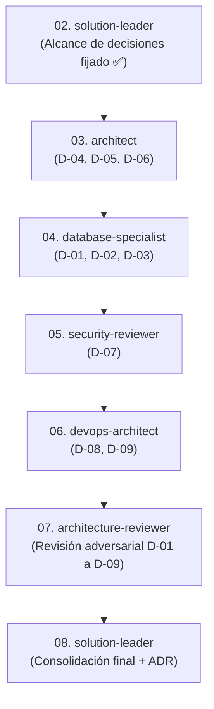

# Alcance de Decisiones Arquitectónicas — Sistema Hospitalario S3IH

Fecha: 2026-10-07  
Fase: 02 — Definición del Alcance de Decisiones  
Rol: `solution-leader`  
Skill: `decision-consolidation`  
Fuente: `01_requirements_analysis.md`, `proyecto/00_contexto/`, `proyecto/01_requisitos/`, `proyecto/02_configuracion/`  
Estado: Aprobado para análisis por especialistas  

---

## 1. Resumen de Contexto y Objetivos

A partir de los drivers identificados en el análisis de requisitos (`01_requirements_analysis.md`), se delimita el conjunto formal de decisiones arquitectónicas requeridas para el **Sistema de Seguimiento de Solicitudes Internas Hospitalarias (S3IH)**. 

El sistema atiende a una red de **hasta 4 hospitales** con servicios asistenciales críticos (Urgencias, Quirófano, UCI) que demandan **operación 24/7 ininterrumpida**, un **volumen base de 3.000 tx/h** (pico de 9.000 tx/h y escalabilidad evaluable a 30.000 tx/h), resguardo desacoplado de evidencias técnicas (hasta 5 MB), **prohibición estricta de borrado físico** e integración con el directorio corporativo hospitalario preexistente.

Este documento establece las decisiones obligatorias, los especialistas que deben intervenir, las alternativas a contrastar y las restricciones no negociables, preservando la neutralidad de stack hasta que cada especialista elabore su análisis técnico justificado.

---

## 2. Decisiones Arquitectónicas que Deben Tomarse

### D-01. Estrategia de Concurrencia y Asignación de Guardias 24/7
| Aspecto | Detalle |
| :--- | :--- |
| **Driver** | D1 (SLA 24/7), D2 (Integridad Transaccional), RF-030, RF-031, RNF-003, CA-004 |
| **Alcance** | Prevenir colisiones, condiciones de carrera y sobreescrituras en la asignación simultánea de técnicos o cuadrillas por múltiples supervisores durante cambios de turno asistencial. |
| **Opciones a comparar** | 1) Bloqueo optimista (*optimistic locking*) basado en columna de versión (`version` / `updated_at`). 2) Bloqueo pesimista (*pessimistic locking*, `SELECT FOR UPDATE`) para transiciones críticas. 3) Semáforos o colas de serialización en capa de aplicación. 4) Esquema híbrido (optimista para consulta/asignación regular, pesimista para cambio de estado en emergencias vitales). |
| **Obligatoria** | **Sí.** Crítico para evitar que dos técnicos atiendan o cierren la misma solicitud concurrente. |
| **Especialistas** | `database-specialist` y `architect`. |
| **Bloquea** | D-02 (Modelo de datos) y D-05 (Estilo arquitectónico). |

---

### D-02. Motor de Persistencia Transaccional y Modelo de Estados
| Aspecto | Detalle |
| :--- | :--- |
| **Driver** | D2 (Atomicidad ACID), D3 (Inmutabilidad), RN-005, RN-012, RNF-013, CA-007 |
| **Alcance** | Seleccionar el motor de base de datos relacional para sostener transacciones ACID, máquina de estados finita determinista, retención histórica $\ge 5\text{ años}$ ($\ge 1.500.000\text{ solicitudes}$) y auditoría append-only sin borrado físico. |
| **Opciones a comparar** | 1) PostgreSQL (robusto en ACID, extensiones, soporte nativo de JSON/UUID y particionamiento por rangos de fecha/sede). 2) MySQL 8.x / MariaDB (alta adopción institucional, replicación probada, transaccionalidad InnoDB). 3) Microsoft SQL Server (integración nativa con infraestructuras Windows/AD corporativas, alta madurez empresarial). |
| **Obligatoria** | **Sí.** Base de la integridad hospitalaria. |
| **Especialistas** | `database-specialist`. |
| **Restricción** | CA-002: Justificación sin preferencia previa; neutralidad demostrada. |

---

### D-03. Estrategia de Idempotencia y Tolerancia a Reintentos
| Aspecto | Detalle |
| :--- | :--- |
| **Driver** | D2 (Integridad), D3 (Inmutabilidad), RN-011, RF-023, RF-042, CA-005 |
| **Alcance** | Garantizar que reintentos de comunicación ocasionados por inestabilidad en la red Wi-Fi hospitalaria no generen solicitudes duplicadas ni transiciones de estado repetidas. |
| **Opciones a comparar** | 1) Clave de idempotencia (*Idempotency-Key* UUID en encabezado HTTP) persistida con TTL e índice único. 2) Restricción de unicidad relacional natural compuesta (ej. `hash_payload` + `usuario_id` + `ventana_tiempo`). 3) Manejo en capa de servicio con verificación de estado previo (transición condicional idempotente). |
| **Obligatoria** | **Sí.** Exigida por RN-011. |
| **Especialistas** | `architect` y `database-specialist`. |

---

### D-04. Almacenamiento Desacoplado de Evidencias Técnicas (Adjuntos hasta 5 MB)
| Aspecto | Detalle |
| :--- | :--- |
| **Driver** | D4 (Almacenamiento desacoplado), Restricción Técnica 5, RF-022, RNF-004, CA-007 |
| **Alcance** | Resguardar fotografías de fallas, fichas técnicas y órdenes de trabajo (hasta 5 MB/archivo, máx. 5 por solicitud) fuera de la base de datos relacional transaccional. |
| **Opciones a comparar** | 1) Almacenamiento de archivos local/montado en red (NAS/NFS corporativo sobre Linux con hash seguro y metadatos en BD). 2) Almacenamiento de objetos on-premise compatible con S3 (MinIO corporativo). 3) Almacenamiento en nube privada institucional. *(Se descarta explícitamente el uso de BLOBs en la BD transaccional por violación de la restricción #5).* |
| **Obligatoria** | **Sí.** Evita la degradación de I/O de la base de datos. |
| **Especialistas** | `architect` y `devops-architect`. |

---

### D-05. Estilo Arquitectónico y Modularidad
| Aspecto | Detalle |
| :--- | :--- |
| **Driver** | D1 (Disponibilidad 24/7), D7 (Proporcionalidad y Simplicidad), RNF-010, RNF-011, RNF-021, CA-003, CA-010 |
| **Alcance** | Determinar la organización estructural de los componentes del software para procesar 3.000 tx/h base, picos de 9.000 tx/h y viabilidad de 10x (30.000 tx/h) sin sobreingeniería. |
| **Opciones a comparar** | 1) **Monolito Modular:** Componentes aislados por módulo funcional (Identidad, Catálogos, Solicitudes, SLA, Bitácora) dentro de una misma unidad de despliegue con base de datos unificada. 2) **Monolito Modular con Worker Desacoplado:** Monolito para la API/Frontend web y un proceso worker en segundo plano para cálculo continuo de SLA, alertas y correos. 3) **Microservicios distribuidos:** Servicios independientes por módulo (se evalúa solo como contraste adversarial para descartar sobreingeniería). |
| **Obligatoria** | **Sí.** Define la estructura del sistema. |
| **Especialistas** | `architect`. |
| **Nota de gobierno** | CA-010 y Restricción Organizacional 4 prohíben la fragmentación innecesaria. |

---

### D-06. Desacoplamiento Asíncrono de Alertas, SLA y Escalamiento
| Aspecto | Detalle |
| :--- | :--- |
| **Driver** | D1 (SLA 24/7), D5 (Tolerancia a Fallos), RF-051, RF-052, RF-053, RNF-041 |
| **Alcance** | Garantizar que el motor de evaluación de SLA (alertas al 75% y escalamiento) y el envío de correos SMTP operen sin degradar ni bloquear las transacciones clínicas de radicación y atención. |
| **Opciones a comparar** | 1) Patrón *Transactional Outbox* en la BD con despachador asíncrono en segundo plano. 2) Cola de mensajes en memoria/ligera (ej. Redis / RabbitMQ). 3) Proceso por lotes programado tipo cron-runner ejecutado periódicamente sobre la BD. |
| **Obligatoria** | **Sí.** Respalda la degradación elegante exigida por RNF-041. |
| **Especialistas** | `architect` y `devops-architect`. |

---

### D-07. Arquitectura de Identidad, Autenticación y Autorización (RBAC)
| Aspecto | Detalle |
| :--- | :--- |
| **Driver** | D6 (Seguridad y Privacidad PHI), RNF-030, RNF-031, RNF-033, RNF-035 |
| **Alcance** | Autenticación institucional contra el directorio corporativo existente (Active Directory / LDAP / SAML / OIDC), control de acceso basado en roles por sede y servicio, y política de cierre de sesión en puestos compartidos (30 min). |
| **Opciones a comparar** | 1) Autenticación directa contra LDAP/AD corporativo con sesiones de servidor protegidas (cookies seguras HttpOnly, SameSite). 2) Autenticación federada (OIDC/OAuth2 corporativo) con tokens de acceso de corta duración. 3) Esquema híbrido (Directorio corporativo para usuarios activos + tabla de contingencia local fuertemente protegida para incidentes de red). |
| **Obligatoria** | **Sí.** Seguridad hospitalaria no negociable. |
| **Especialistas** | `security-reviewer`. |

---

### D-08. Estrategia de Despliegue, Contenerización y Resiliencia
| Aspecto | Detalle |
| :--- | :--- |
| **Driver** | D7 (Simplicidad), D8 (Portabilidad Linux LTS/OCI), RNF-040, RNF-050, RNF-051, RNF-080, RNF-081, CA-010 |
| **Alcance** | Empaquetamiento en imágenes OCI, orquestación proporcionada, alta disponibilidad ($99.9\%$), y procedimientos de recuperación con $\text{RPO} \le 60\text{ min}$ y $\text{RTO} \le 180\text{ min}$. Justificación explícita de usar o NO usar Kubernetes. |
| **Opciones a comparar** | 1) Despliegue en contenedores Docker/Podman sobre servidores Linux empresariales (LTS) con balanceador de carga Nginx/HAProxy y réplica de base de datos primaria-secundaria. 2) Orquestación ligera mono/multi-nodo con K3s o Docker Swarm. 3) Clúster de Kubernetes completo (se evaluará críticamente contra el criterio de proporcionalidad CA-010). |
| **Obligatoria** | **Sí.** RNF-081 y CA-010 lo exigen. |
| **Especialistas** | `devops-architect`. |

---

### D-09. Estrategia de Observabilidad y Monitoreo Operativo
| Aspecto | Detalle |
| :--- | :--- |
| **Driver** | D3 (Auditoría), D8 (Operabilidad), RNF-070, RNF-071, RNF-072 |
| **Alcance** | Generación de logs estructurados JSON con estampa UTC, correlación de solicitudes (*Correlation ID*), métricas de latencia p95 y monitoreo del estado de las colas de SLA. |
| **Opciones a comparar** | 1) Logging estructurado estándar a disco rotativo con agente de agregación corporativo existente. 2) Stack open source autocontenido (Prometheus + Grafana + Loki). 3) OpenTelemetry con colector ligero centralizado. |
| **Obligatoria** | **Sí.** Exigida por RNF-070-072. |
| **Especialistas** | `devops-architect`. |

---

## 3. Matriz de Especialistas Necesarios y Responsabilidades

| Orden | Especialista | Decisiones Asignadas | Salida Esperada en `03_resultados/` | Dependencias |
| :---: | :--- | :--- | :--- | :--- |
| **1** | `architect` | D-05 (Estilo arquitectónico), D-04 (Almacenamiento adjuntos), D-06 (Desacoplamiento asíncrono) | `03_architecture_options.md` | Ninguna (toma como base `01` y `02`). |
| **2** | `database-specialist` | D-01 (Concurrencia de guardia), D-02 (Motor DBMS), D-03 (Idempotencia en BD) | `04_database_analysis.md` | Conoce las opciones planteadas por `architect`. |
| **3** | `security-reviewer` | D-07 (Autenticación LDAP/AD, RBAC, timeout, privacidad PHI) | `05_security_analysis.md` | Revisa las opciones de arquitectura y persistencia. |
| **4** | `devops-architect` | D-08 (Despliegue OCI, justificación No-Kubernetes, RPO/RTO), D-09 (Observabilidad) | `06_devops_analysis.md` | Conoce el motor DBMS y la arquitectura del sistema. |
| **5** | `architecture-reviewer` | Revisión adversarial integral de D-01 a D-09 contra RF/RNF y criterios CA-001 a CA-011 | `07_architecture_review.md` | Requiere los informes 03, 04, 05 y 06 completos. |
| **6** | `solution-leader` | Consolidación final, matriz de ponderación, recomendación única y borrador de ADR | `08_recomendacion_final.md` | Requiere el dictamen de `architecture-reviewer`. |

---

## 4. Restricciones Críticas No Negociables (Guardrails)

| ID | Restricción Crítica | Origen | Impacto en las Propuestas |
| :--- | :--- | :--- | :--- |
| **RC-01** | **Entorno de ejecución Linux empresarial (LTS)** | Restricción Técnica 2 | Descarta tecnologías o dependencias atadas exclusivamente a Windows o plataformas propietarias. |
| **RC-02** | **Empaquetamiento obligatorio en contenedores OCI** | Restricción Técnica 3 | Todos los componentes deben generar imágenes estándar compatibles con Docker/Podman. |
| **RC-03** | **Prohibición absoluta de secretos en código o repositorios** | Restricción Técnica 4 | Configuración por variables de entorno inyectadas externamente. |
| **RC-04** | **Prohibición de BLOBs en la base de datos relacional** | Restricción Técnica 5 | Los adjuntos técnicos (fotos/PDFs hasta 5 MB) deben residir en almacenamiento desacoplado. |
| **RC-05** | **Desacoplamiento asíncrono de dependencias periféricas** | Restricción Técnica 6 | La caída o lentitud de SMTP o generador de reportes no puede bloquear la radicación ni el flujo de estados. |
| **RC-06** | **Operación continua 24/7 en servicios de soporte vital** | Restricción Organizacional 1 | Mantenimientos y actualizaciones sin pérdida de disponibilidad asistencial en Urgencias/Quirófano/UCI. |
| **RC-07** | **Segregación de funciones (SoD)** | Restricción Organizacional 2 | Solicitantes no alteran estados técnicos; técnicos no pueden auto-aprobarse ni cambiar parámetros globales. |
| **RC-08** | **Prohibición absoluta de borrado físico (Inmutabilidad)** | RN-012, RN-013 | Solo bajas lógicas y registros terminales; retención obligatoria $\ge 5\text{ años}$. |
| **RC-09** | **Proporcionalidad y descarte de sobreingeniería** | CA-010, Restr. Org. 4 | Mantenible por el equipo de TI interno. Descartar microservicios o Kubernetes si un monolito modular satisface los RNF. |
| **RC-10** | **Objetivos estrictos de recuperación: RPO $\le 60$ min, RTO $\le 180$ min** | RNF-050, RNF-051 | Procedimientos de respaldo coordinado entre base de datos y adjuntos. |

---

## 5. Preguntas Pendientes para la Mesa Técnica

| # | Pregunta Técnica Pendiente | Afecta Directamente a | Estrategia Provisional para los Especialistas |
| :--- | :--- | :--- | :--- |
| **1** | ¿La red institucional entre hospitales dispone de conectividad WAN privada robusta o existe riesgo de enlaces intermitentes prolongados? | `devops-architect` (D-08), `database-specialist` (D-02) | Diseñar asumiendo enlaces WAN confiables con base de datos centralizada en hospital central, evaluando el impacto de enlaces degradados. |
| **2** | ¿Se cuenta con almacenamiento tipo S3 (ej. MinIO) institucional o se prefiere volumen compartido NAS/NFS montado sobre Linux? | `architect` (D-04), `devops-architect` (D-08) | Diseñar un adaptador de almacenamiento con interfaz desacoplada que soporte tanto almacenamiento en disco/NAS como MinIO/S3 mediante configuración. |
| **3** | ¿Existe servidor de mensajería asíncrona existente en el hospital (RabbitMQ/Redis) o debe gestionarse dentro de la infraestructura de persistencia? | `architect` (D-06) | Proponer una opción ligera autocontenida (ej. Transactional Outbox en BD o Redis ligero en contenedor). |
| **4** | ¿El escalamiento de SLA crítico requiere integraciones más allá de correo y web (ej. WhatsApp/SMS de guardia)? | `architect` (D-06), `security-reviewer` (D-07) | Mantener la arquitectura abierta a proveedores de mensajería externos a través de adaptadores de notificación asíncronos. |

---

## 6. Orden Secuencial de Intervención

---

## 7. Criterios de Aceptación Cubiertos por este Alcance

| Criterio | Estado de Cumplimiento en este Alcance |
| :--- | :--- |
| **CA-001. Trazabilidad integral** | ✅ Cada decisión (D-01 a D-09) está formalmente vinculada a sus respectivos RF, RNF y reglas de negocio. |
| **CA-002. Neutralidad tecnológica inicial** | ✅ Ninguna decisión impone un motor o lenguaje por preferencia; se establecen 2 a 4 opciones objetivas a comparar. |
| **CA-003. Comparación objetiva de alternativas** | ✅ D-05 y D-08 exigen explícitamente contrastar al menos 2 alternativas viables con balance de trade-offs. |
| **CA-004. Control de concurrencia** | ✅ D-01 está dedicado exclusivamente a prevenir condiciones de carrera durante cambios de turno de guardias 24/7. |
| **CA-005. Idempotencia formal** | ✅ D-03 delimita los mecanismos para evitar duplicados en radicación y cambios de estado. |
| **CA-006. Capacidad y evaluación de 10x** | ✅ D-05, D-08 y D-02 fijan los requerimientos de absorción de 3.000 tx/h, picos de 9.000 tx/h y viabilidad a 30.000 tx/h. |
| **CA-007. Persistencia y adjuntos desacoplados** | ✅ D-02 y D-04 garantizan transaccionalidad ACID y prohíben el almacenamiento de binarios en la BD. |
| **CA-008. Operación continua 24/7 y SLA** | ✅ D-01, D-05 y D-06 aseguran cálculo continuo y escalamiento sin interrupción. |
| **CA-009. Recuperación (RPO $\le 60$ min, RTO $\le 180$ min)** | ✅ D-08 y RC-10 integran explícitamente las metas de recuperación ante desastres. |
| **CA-010. Proporcionalidad y no sobreingeniería** | ✅ D-05 y D-08 prohíben microservicios o Kubernetes sin justificación técnica demostrada. |
| **CA-011. Ausencia de hallazgos bloqueantes** | ✅ Las preguntas pendientes cuentan con hipótesis de diseño provisionales para permitir que los especialistas avancen sin bloqueos. |

---

## 8. Traspaso a la Siguiente Fase

Queda formalmente delimitado el alcance de decisiones para el sistema S3IH.

El siguiente paso obligatorio corresponde a **`architect`**, quien desarrollará las opciones estructurales en:  
📄 [`proyecto/03_resultados/03_architecture_options.md`](file:///d:/mod3proyectoclone/MAESTRIA_EN_INGENIERIA_DE_SOFTWARE_Y_SISTEMAS_INFORMATICO/MODULO_3_DESARROLLO_AL_LADO_DEL_CLIENTE_Y_SERVIDOR_WEB/architecture-skills-framework/proyecto/03_resultados/03_architecture_options.md).
