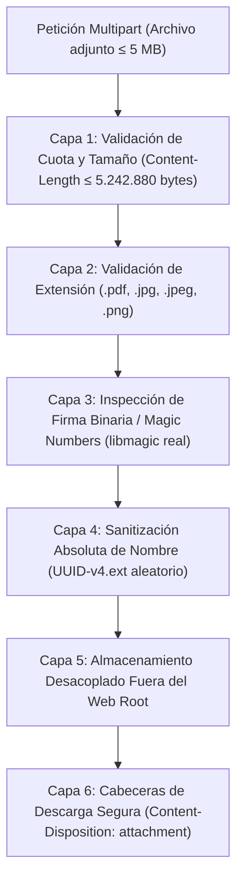

# Análisis de Seguridad, Identidad y Privacidad (D-07) — Sistema Hospitalario S3IH

Fecha: 2026-10-07  
Fase: 05 — Revisión de Seguridad y Cumplimiento  
Rol: `security-reviewer`  
Skill: `security-review`  
Fuente: `01_requirements_analysis.md`, `02_decision_scope.md`, `03_architecture_options.md`, `04_database_analysis.md`  
Estado: Aprobado para revisión de infraestructura y consolidación  

---

## 1. Resumen Ejecutivo y Requisitos de Seguridad

El **Sistema de Seguimiento de Solicitudes Internas Hospitalarias (S3IH)** opera dentro del perímetro de una red hospitalaria de **hasta 4 hospitales** donde interactúan más de 700 usuarios concurrentes en puestos fijos clínicos (quirófanos, puestos de enfermería) y terminales móviles en carros de guardia.

Aunque el sistema **NO es un Expediente Clínico Electrónico (EHR/HIS)**, gestiona solicitudes sobre activos que sustentan la vida de pacientes (soporte vital en UCI, ventiladores, aire medicinal, equipamiento quirúrgico). Por ende, una alteración maliciosa, suplantación de identidad o indisponibilidad inducida representa un **riesgo directo para la continuidad asistencial y la seguridad del paciente**.

### Matriz de Requisitos No Funcionales de Seguridad

| ID | Requisito Formal | Mecanismo Arquitectónico de Cumplimiento |
| :--- | :--- | :--- |
| **RNF-030** | Autenticación institucional integrada y timeout de inactividad de 30 min | Integración con Directorio Activo (AD/LDAP corporativo) + sesiones seguras de servidor con expiración estricta en puestos compartidos. |
| **RNF-031** | Control de acceso basado en roles (RBAC) y mínimo privilegio | Matriz RBAC multidimensional: Rol funcional $\times$ Sede hospitalaria $\times$ Servicio asignado. |
| **RNF-032** | Cifrado en tránsito y en reposo | Cifrado obligatorio TLS 1.3 / HTTPS en tránsito; cifrado AES-256 en reposo para volúmenes de base de datos y repositorio de adjuntos. |
| **RNF-033** | Gestión externa de secretos y contraseñas seguras | Prohibición absoluta de credenciales en código/repositorio; inyección mediante variables de entorno; contingencia local con Argon2id/bcrypt. |
| **RNF-034** | Validación y saneamiento de entradas y subida de archivos (5 MB) | Validación de firmas binarias (magic numbers/MIME real), tamaño $\le 5\text{ MB}$, renombramiento a UUID v4 y almacenamiento desacoplado fuera del web root. |
| **RNF-035** | Aislamiento y protección estricta de datos clínicos de pacientes (PHI) | Política *Zero-PHI*: validaciones en frontend/backend que impiden almacenar diagnósticos o expedientes clínicos en campos descriptivos. |
| **RN-012/013** | Inmutabilidad, no repudio y trazabilidad legal de auditoría | Revocación de `DELETE` en BD (`REVOKE DELETE`); pista inmutable con estampa UTC del servidor, IP de origen y usuario responsable. |

---

## 2. Modelado de Amenazas Hospitalario (STRIDE Aplicado a S3IH)

```
┌────────────────────────────────────────────────────────────────────────────────────────┐
│               Modelo STRIDE para la Red Hospitalaria (S3IH)                            │
├─────────────────────┬──────────────────────────────────────────────────────────────────┤
│ Spoofing (Supl.)    │ Suplantación de médicos/técnicos en terminales compartidas       │
│ Tampering (Alter.)  │ Modificación no autorizada de prioridades de SLA o informes      │
│ Repudiation (Rep.)  │ Negación de asignación o cierre indebido de solicitudes vitales  │
│ Info Disclosure     │ Fuga accidental de datos protegidos de pacientes (PHI)           │
│ DoS (Denegación)    │ Saturación de I/O mediante subida masiva de archivos de 5 MB     │
│ Elev. of Privilege  │ Técnicos auto-asignándose o auto-aprobando cierres sin auditoría │
└─────────────────────┴──────────────────────────────────────────────────────────────────┘
```

1. **Spoofing (Suplantación de Identidad en Puestos Compartidos):** En quirófanos y urgencias, múltiples profesionales comparten una misma terminal física. **Mitigación:** Timeout forzado de 30 minutos de inactividad (RNF-030), reautenticación requerida para transiciones críticas a 'Cerrada' o 'Rechazada', y bloqueo de reanudación automática.
2. **Tampering (Alteración de Tiempos o Prioridades):** Modificar la prioridad asistencial para saltarse la cola de atención o alterar la bitácora técnica. **Mitigación:** Máquina de estados determinista en base de datos; la alteración de prioridad exige justificación y firma de auditoría (RN-008); bitácora inmutable en append-only.
3. **Repudiation (Repudio de Responsabilidad):** Un técnico o supervisor niega haber rechazado o cerrado una orden de soporte vital. **Mitigación:** Tabla de auditoría protegida (`solicitudes_historial_estados`) con IP de origen, usuario LDAP validado y estampa temporal UTC del servidor (RN-013).
4. **Information Disclosure (Fuga de Datos de Salud Protegidos - PHI):** Personal asistencial introduciendo datos confidenciales de pacientes (nombre, cédula, diagnóstico) en la descripción de fallas biomédicas. **Mitigación:** Advertencias explícitas en interfaz, filtros heurísticos de prevención de ingreso de PHI y segregación lógica de roles (RNF-035).
5. **Denial of Service (Agotamiento de Recursos por Adjuntos):** Envío masivo de imágenes de 5 MB para agotar el espacio en disco o saturar la memoria del servidor. **Mitigación:** Cuota estricta de máximo 5 archivos por requerimiento (límite acumulado de 25 MB), validación de tamaño en streaming antes de escribir en disco permanente y *rate limiting* por IP y usuario.
6. **Elevation of Privilege (Salto de Privilegios y Falta de SoD):** Un técnico reasignándose solicitudes o modificando calendarios de SLA. **Mitigación:** Segregación estricta de funciones (SoD, Restr. Org. 2) validada en la capa de negocio y esquema RBAC rígido.

---

## 3. Evaluación de Alternativas de Identidad y Autenticación (D-07)

```
┌────────────────────────────────────────────────────────────────────────────────────────┐
│                  Alternativas de Autenticación para el Sistema S3IH                    │
├──────────────────────────┬─────────────────────────────┬───────────────────────────────┤
│ Opción 1: LDAP/AD Directo│ Opción 2: Gateway SSO       │ Opción 3: JWT sin Estado      │
│ + Sesiones de Servidor   │ (OIDC / SAML Corporativo)   │ (Tokens en Cliente)           │
├──────────────────────────┼─────────────────────────────┼───────────────────────────────┤
│ - Cookies HttpOnly Seguras│ - IdP corporativo central   │ - Token viaja en encabezado   │
│ - Invalidación inmediata │ - Soporte nativo de MFA     │ - Revocación compleja         │
│ - Timeout estricto 30 min│ - Dependencia de red al IdP │ - Vulnerable en puestos comp. │
│ - Cero riesgo de fuga XSS│ - Tokens de corta duración  │ - Blacklist en BD requerida   │
└──────────────────────────┴─────────────────────────────┴───────────────────────────────┘
```

### Tabla Comparativa de Mecanismos de Autenticación

| Criterio de Seguridad | Opción 1: LDAP/AD Directo + Sesiones de Servidor | Opción 2: SSO OIDC/SAML Corporativo | Opción 3: JWT sin Estado |
| :--- | :--- | :--- | :--- |
| **Resistencia en Terminales Compartidas (RNF-030)** | **Excelente.** La sesión reside en memoria/servidor. La invalidación al expirar los 30 minutos o al presionar "Cerrar Sesión" es **instantánea y garantizada**. | **Excelente.** El proveedor de identidad gestiona la caducidad y el cierre global de sesión (*Single Sign-Out*). | **Deficiente.** Los JWTs no se invalidan fácilmente sin una tabla de revocación (blacklist) en base de datos, lo que destruye el propósito de ser "stateless". |
| **Protección contra Ataques XSS / Robo de Tokens** | **Máxima.** Las cookies de sesión se emiten con banderas `HttpOnly; Secure; SameSite=Strict`. Ningún script inyectado vía XSS puede extraer la sesión. | **Alta.** Si los tokens se almacenan en cookies de servidor seguras. | **Baja-Media.** Si el JWT se almacena en `localStorage` o `sessionStorage`, es vulnerable a exfiltración completa mediante XSS. |
| **Integración con Infraestructura Hospitalaria** | **Nativa y Directa.** Toda red hospitalaria dispone de controladores de dominio Microsoft Active Directory o servidores OpenLDAP corporativos. | **Muy Buena.** Requiere que la red hospitalaria cuente con un IdP configurado (ej. Keycloak, ADFS, Ping, Okta). | **Aislada.** Exige gestionar el ciclo de vida de usuarios de forma interna o sincronizada. |
| **Complejidad de Mantenimiento para TI Interno** | **Baja.** Protocolo estándar ampliamente dominado por el personal de infraestructura hospitalaria. | **Media-Alta.** Requiere coordinar registros de clientes, secretos de cliente y rotación de certificados federados. | **Media.** Requiere implementación propia de refresh tokens y blacklists. |
| **Tolerancia a Contingencias de Red** | **Buena.** Permite configurar una cuenta local de contingencia fuertemente protegida (Argon2id) para emergencias aisladas. | **Rígida.** Si el IdP corporativo sufre una interrupción, el sistema queda completamente inaccesible. | **Buena.** Depende de la validación local de firmas de token. |

### Decisión de Identidad: Opción 1 (Recomendada) con Capacidad OIDC
Se selecciona la **Opción 1: Autenticación contra Directorio Activo (AD/LDAP) corporativo con Sesiones de Servidor Seguras (Cookies HttpOnly)** como mecanismo primario:
- Cumple directamente el requisito de **cierre automático a los 30 minutos** (RNF-030).
- Resguarda las credenciales de los puestos de trabajo compartidos en quirófano.
- Mantiene arquitectura modular abierta para transicionar a **Opción 2 (OIDC)** mediante configuración si la dirección de TI habilita un proveedor institucional federado.

---

## 4. Matriz de Autorización Basada en Roles (RBAC) y Segregación de Funciones

Se establece una matriz RBAC multidimensional estricta bajo el **principio de mínimo privilegio (RNF-031)** y **segregación de funciones (Restr. Org. 2)**:

| Módulo / Acción del Sistema | Solicitante Asistencial | Técnico Resolutor | Supervisor de Guardia | Administrador de TI | Comité de Calidad / Auditoría |
| :--- | :---: | :---: | :---: | :---: | :---: |
| **Radicar Solicitud Ordinaria / Expedita** | ✅ Permitido | ❌ Denegado | ✅ Permitido | ❌ Denegado | ❌ Denegado |
| **Cancelar Solicitud Propia (antes de proceso)** | ✅ Permitido (RN-009) | ❌ Denegado | ❌ Denegado | ❌ Denegado | ❌ Denegado |
| **Asignar / Reasignar Solicitudes de Guardia** | ❌ Denegado | ❌ Denegado | ✅ Permitido (RN-008) | ✅ Permitido | ❌ Denegado |
| **Tomar en Proceso Solicitud Asignada** | ❌ Denegado | ✅ Solo asignadas | ❌ Denegado | ❌ Denegado | ❌ Denegado |
| **Pausar SLA a Estado 'En Espera'** | ❌ Denegado | ✅ Con motivo (RN-006)| ✅ Permitido | ❌ Denegado | ❌ Denegado |
| **Registrar Informe Técnico y Pasar a 'Atendida'** | ❌ Denegado | ✅ Obligatorio (RN-007)| ❌ Denegado | ❌ Denegado | ❌ Denegado |
| **Rechazar Solicitud Técnica** | ❌ Denegado | ❌ Denegado | ✅ Con causal (RN-009)| ❌ Denegado | ❌ Denegado |
| **Reapertura de Solicitud ($\le 48\text{ h}$ post-atención)** | ✅ Permitido (RN-010) | ❌ Denegado | ✅ Permitido | ❌ Denegado | ❌ Denegado |
| **Configurar Catálogos, Sedes y Umbrales de SLA** | ❌ Denegado | ❌ Denegado | ❌ Denegado | ✅ Exclusivo TI | ❌ Denegado |
| **Consultar Pistas de Auditoría e Indicadores** | ❌ Solo solicitudes propias | ❌ Solo órdenes asignadas | ✅ Reportes de su servicio | ✅ Monitoreo técnico | ✅ Solo Lectura Completo |

### Regla Inviolable de Segregación de Funciones (SoD):
- Un usuario con rol de **Técnico Resolutor** tiene terminantemente bloqueada la capacidad de auto-aprobarse solicitudes o cambiar estados a 'Cerrada' sin confirmación de conformidad asistencial.
- Un usuario con rol de **Solicitante Asistencial** no puede modificar estados técnicos una vez que la orden transicionó a 'En Proceso'.
- El rol **Administrador de TI** no puede alterar los registros históricos de intervenciones técnicas ni los logs de auditoría.

---

## 5. Seguridad en Carga y Resguardo de Adjuntos Técnicos (RNF-034, D-04)

Los archivos adjuntos representan el vector de ataque más vulnerable para ejecución remota de código (RCE), desbordamiento de almacenamiento y path traversal. Se implementa una **tubería de validación defensiva en 6 capas**:



1. **Capa 1 (Cuota y Tamaño Estricto):** La petición HTTP se rechaza inmediatamente si excede 5 MB ($5.242.880\text{ bytes}$) a nivel del proxy inverso (Nginx: `client_max_body_size 5M`) y de la aplicación.
2. **Capa 2 (Lista Blanca de Extensiones):** Solo se admiten extensiones en minúsculas: `.pdf`, `.jpg`, `.jpeg`, `.png`. Cualquier extensión de script executable (`.php`, `.sh`, `.exe`, `.js`, `.phtml`, etc.) es rechazada.
3. **Capa 3 (Inspección de Firmas Binarias / Magic Numbers):** El backend no confía en la cabecera `Content-Type` enviada por el navegador. Inspecciona los primeros bytes del flujo binario:
   - PDF: `%PDF-` (`0x25 0x50 0x44 0x46`)
   - JPEG: `0xFF 0xD8 0xFF`
   - PNG: `0x89 0x50 0x4E 0x47 0x0D 0x0A 0x1A 0x0A`
4. **Capa 4 (Sanitización y Ofuscación de Nombre):** El nombre original del archivo se descarta para el almacenamiento en disco. El archivo físico se renombra exclusivamente a `<UUIDv4>.<extension_validada>`, eliminando cualquier posibilidad de ataques de *Directory Traversal* (`../../`).
5. **Capa 5 (Almacenamiento Fuera de la Raíz Web):** Los archivos residen en una ruta desacoplada del sistema de archivos sin permisos de ejecución (`noexec` en el punto de montaje NAS/NFS) o en un bucket privado de MinIO.
6. **Capa 6 (Descarga Segura sin Ejecución en Línea):** Las descargas de archivos adjuntos se sirven obligatoriamente con cabeceras que impiden la ejecución en el contexto del navegador:
   ```http
   Content-Disposition: attachment; filename="evidencia_tecnica.pdf"
   X-Content-Type-Options: nosniff
   Content-Security-Policy: default-src 'none'
   ```

---

## 6. Prevención y Aislamiento de Datos de Salud Protegidos (Zero-PHI - RNF-035)

Para satisfacer la restricción de **aislamiento estricto de historias clínicas de pacientes**:
1. **Diseño de Formularios:** Ningún campo del sistema solicita, insinúa ni titula datos de pacientes (cero campos de nombres de paciente, diagnósticos médicos, números de cama clínica asociados a identidad o tratamientos).
2. **Filtros de Expresiones Regulares en Validación:** Se implementa un filtro preventivo en el backend que detecta y rechaza la inserción de números de identificación nacional / cédulas o formatos típicos de historia clínica hospitalaria dentro del campo de descripción del daño técnico.
3. **Aviso Legal Vinculante en Pantalla:** Banner visible permanente en el formulario de radicación: *"Sistema exclusivo para mantenimiento técnico y soporte logístico. Queda terminantemente prohibido ingresar datos personales o diagnósticos médicos de pacientes conforme a la ley de protección de datos en salud."*

---

## 7. Gestión de Secretos, Entornos y Seguridad de APIs (RNF-032, RNF-033)

1. **Gestión Externa de Secretos (Zero-Secrets in Code):**
   - Queda prohibido escribir contraseñas de bases de datos, claves LDAP o secretos de sesión en archivos PHP, JS, YAML o markdown versionados en Git.
   - Todo secreto se inyecta en tiempo de ejecución mediante variables de entorno del contenedor Docker/Podman (`.env` local ignorado por Git, inyectado por el orquestador).
2. **Protección Criptográfica de Comunicaciones:**
   - Cifrado obligatorio TLS 1.3 / HTTPS. Se configura la cabecera HSTS (*HTTP Strict Transport Security*):
     ```http
     Strict-Transport-Security: max-age=31536000; includeSubDomains
     ```
3. **Cabeceras de Seguridad HTTP Globales:**
   - `X-Frame-Options: DENY` (previene ataques de Clickjacking en estaciones de enfermería).
   - `X-Content-Type-Options: nosniff`.
   - `Referrer-Policy: strict-origin-when-cross-origin`.
   - `Content-Security-Policy: default-src 'self'; script-src 'self'; style-src 'self' 'unsafe-inline'; img-src 'self' data:;`.
4. **Defensa contra Ataques de Fuerza Bruta y DoS:**
   - *Rate Limiting* estricto en el endpoint de autenticación `/login`: Máximo 5 intentos fallidos por IP/usuario cada 15 minutos.
   - Bloqueo temporal y notificación en bitácora de seguridad ante detección de intentos anómalos.

---

## 8. Pista de Auditoría Legal e Inmutabilidad (RN-012, RN-013, RF-072)

En cumplimiento de las leyes de acreditación hospitalaria que exigen **retención inmutable de al menos 5 años**:
1. **Atributos Obligatorios por Cada Transacción:**
   - `usuario_id` (identificador inmutable del usuario autenticado vía LDAP).
   - `ip_origen` (dirección IP corporativa del cliente, capturada de forma confiable tras el reverse proxy mediante cabecera `X-Forwarded-For` sanitizada).
   - `fecha_hora_utc` (estampa de tiempo sincronizada generada exclusivamente por el reloj del servidor, nunca por el cliente).
   - `estado_anterior` y `estado_nuevo`.
   - `justificacion_motivo` (obligatoria con longitud $\ge 20$ caracteres en cancelaciones, rechazos o reaperturas).
2. **Garantía Criptográfica y de No Repudio:**
   - La tabla `solicitudes_historial_estados` se resguarda con permisos revocados (`REVOKE UPDATE, DELETE`).
   - Se incluye un campo `hash_registro` (SHA-256 encadenado del registro anterior) para verificar matemáticamente que la bitácora no ha sido manipulada en la base de datos por personal con acceso a nivel de infraestructura.

---

## 9. Dictamen y Traspaso a DevOps

El especialista en seguridad concluye que:
> 1. La arquitectura seleccionada (**Monolito Modular con Sesiones de Servidor Seguras integradas a Directorio Activo/LDAP**) ofrece el máximo nivel de protección para estaciones compartidas en quirófanos y enfermería, eliminando la vulnerabilidad de tokens desasistidos.
> 2. La tubería de 6 capas para subida de archivos adjuntos mitiga completamente el riesgo de saturación de disco y ejecución remota de código.
> 3. La política *Zero-PHI* y el control estricto de RBAC con segregación de funciones blindan a la institución frente a sanciones de privacidad médica.

El siguiente paso obligatorio corresponde a **`devops-architect`**, quien formalizará la infraestructura, contenedores OCI, exclusión de Kubernetes, RPO/RTO y observabilidad en:  
📄 [`proyecto/03_resultados/06_devops_analysis.md`](file:///d:/mod3proyectoclone/MAESTRIA_EN_INGENIERIA_DE_SOFTWARE_Y_SISTEMAS_INFORMATICO/MODULO_3_DESARROLLO_AL_LADO_DEL_CLIENTE_Y_SERVIDOR_WEB/architecture-skills-framework/proyecto/03_resultados/06_devops_analysis.md).
