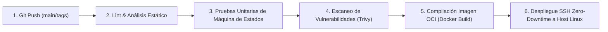

# Análisis de Infraestructura, Despliegue y Operaciones (D-08, D-09) — Sistema Hospitalario S3IH

Fecha: 2026-10-07  
Fase: 06 — Evaluación de Infraestructura y DevOps  
Rol: `devops-architect`  
Skill: `infrastructure-evaluation`  
Fuente: `01_requirements_analysis.md`, `02_decision_scope.md`, `03_architecture_options.md`, `04_database_analysis.md`, `05_security_analysis.md`  
Estado: Aprobado para revisión adversarial y consolidación  

---

## 1. Resumen Ejecutivo y Drivers de Infraestructura

El despliegue del **Sistema de Seguimiento de Solicitudes Internas Hospitalarias (S3IH)** debe soportar la operación de una red de **hasta 4 hospitales** bajo condiciones de alta confiabilidad asistencial y presupuesto operacional restringido.

### Parámetros Operativos Clave
- **Disponibilidad Asistencial Exigida:** $\ge 99.9\%$ anual ($< 8.76\text{ horas/año}$ de indisponibilidad no planificada, RNF-040).
- **Rendimiento:** Latencia de consultas $p95 \le 400\text{ ms}$, transacciones de escritura $p95 \le 800\text{ ms}$ (RNF-001, RNF-003).
- **Throughput:** $3.000\text{ tx/h}$ nominal ($\approx 0.83\text{ tx/s}$), picos de $9.000\text{ tx/h}$ ($\approx 2.5\text{ tx/s}$), escenario 10x de $30.000\text{ tx/h}$ ($\approx 8.33\text{ tx/s}$).
- **Metas de Recuperación ante Desastres:** $\text{RPO} \le 60\text{ min}$, $\text{RTO} \le 180\text{ min}$ (RNF-050, RNF-051).
- **Restricciones Técnicas No Negociables:** Linux empresarial (LTS) obligatorio (RNF-080), contenedores OCI estándar (RNF-081), sin secretos en código (RNF-033, Restr. Téc. 4), almacenamiento desacoplado de evidencias de hasta 5 MB (Restr. Téc. 5, RNF-004), y **justificación explícita de NO usar Kubernetes por sobreingeniería (CA-010, Restr. Org. 4)**.

---

## 2. Evaluación de Estrategias de Despliegue y Orquestación (D-08)

```
┌────────────────────────────────────────────────────────────────────────────────────────┐
│               Evaluación de Opciones de Despliegue para la Red Hospitalaria            │
├──────────────────────────┬─────────────────────────────┬───────────────────────────────┤
│ Opción 1: Docker / Podman│ Opción 2: Orquestador Ligero│ Opción 3: Clúster Kubernetes  │
│ Compose en Linux LTS     │ (K3s / Docker Swarm)        │ Completo (K8s / OpenShift)    │
├──────────────────────────┼─────────────────────────────┼───────────────────────────────┤
│ - 3 contenedores OCI     │ - Orquestación mono/multi   │ - Alta complejidad de red     │
│ - Mantenimiento mínimo   │ - Curva de aprendizaje media│ - 5+ nodos dedicados          │
│ - Cero costo adicional   │ - Auto-healing de pods      │ - Violación de CA-010         │
│ - Óptimo para 0.83 tx/s  │ - YAMLs de deployment       │ - Sobreingeniería extrema     │
└──────────────────────────┴─────────────────────────────┴───────────────────────────────┘
```

### Tabla Comparativa de Estrategias de Despliegue

| Criterio de Selección | Opción 1: Contenedores OCI (Docker/Podman Compose) | Opción 2: Orquestador Ligero (K3s / Swarm) | Opción 3: Kubernetes Completo (K8s / OpenShift) |
| :--- | :--- | :--- | :--- |
| **Complejidad Operacional y Mantenibilidad (CA-010)** | **Baja.** Operación transparente mediante archivos `compose` versionados. Mantenible directamente por el equipo interno de TI hospitalario sin contratar especialistas externos. | **Media.** Demanda administración de manifests de Kubernetes, objetos Service, Ingress y red de pods interna. | **Extrema.** Demanda administración continua de Control Plane, etcd, CNI, CSI, certificados internos y cuadrilla dedicada de SREs. |
| **Consumo de Recursos en Reposo** | **Mínimo.** Sobrecarga del motor de contenedores $< 50\text{ MB}$ de RAM. El 95% de la máquina virtual se dedica al backend y a la base de datos. | **Bajo.** Sobrecarga de K3s $\approx 500\text{ MB}$ a $1\text{ GB}$ de RAM. | **Muy Alto.** El plano de control de K8s requiere $\ge 4\text{ a }8\text{ GB}$ de RAM y múltiples vCPUs solo para funcionar en reposo. |
| **Disponibilidad 99.9% y Auto-Healing** | **Alta.** Mecanismo nativo de reinicio automático (`restart: unless-stopped` / `always`). Health checks periódicos mediante Docker healthcheck. | **Muy Alta.** Re-programación automática de pods ante caídas de nodo si se despliega en clúster multi-nodo. | **Muy Alta.** Auto-healing y escalado horizontal automático nativo (HPA). |
| **Capacidad para Absorber 10x ($30.000\text{ tx/h}$)** | **Comprobada.** $8.33\text{ tx/s}$ requiere menos del 5% de CPU de un host estándar de 4 vCPUs. Soporta hasta $500\text{ tx/s}$ sin orquestación. | **Comprobada.** Soporta escalado horizontal de réplicas web. | **Comprobada**, pero desproporcionada en una relación de 100 a 1. |
| **Costo Operacional y de Infraestructura** | **Óptimo.** Cero costo de licencias de software, opera sobre 2 máquinas virtuales corporativas estándar (Primaria y Réplica). | **Bajo.** Software open-source sin costo de licencia. | **Inviable.** Costos elevados de hardware, almacenamiento distribuido y consultoría externa. |

---

## 3. Justificación Técnica Formal del Descarte de Kubernetes (CA-010)

El criterio **CA-010** y la **Restricción Organizacional 4** exigen explícitamente evitar sobreingeniería y justificar de forma rigurosa usar o **NO usar Kubernetes**:

### Motivos Técnicos del Rechazo de Kubernetes:
1. **Desproporción Métrica de Carga:**
   - La red de 4 hospitales genera una carga nominal de **$0.83\text{ transacciones por segundo}$** ($3.000\text{ tx/h}$) con un pico proyectado de **$2.5\text{ tx/s}$** ($9.000\text{ tx/h}$).
   - Kubernetes fue diseñado para gestionar cientos de microservicios y decenas de miles de peticiones por segundo en arquitecturas masivas hiperdistribuidas. Desplegar un clúster K8s para procesar $2.5\text{ tx/s}$ representa un sobredimensionamiento de **más de tres órdenes de magnitud (1.000x)**.
2. **Sobrecarga de Gestión para el Equipo de TI Interno:**
   - El equipo de TI de la red hospitalaria administra infraestructura clínica, redes y soporte a usuarios. No dispone de un equipo dedicado de ingenieros de confiabilidad de sitios (SRE) con dedicación exclusiva 24/7 a la gestión de clústeres.
   - Las fallas típicas de Kubernetes (problemas de red CNI, expiración silenciosa de certificados TLS del plano de control, corrupción de quorum etcd, fallos de storage class) son complejas de diagnosticar y generan un **riesgo real de indisponibilidad asistencial inducida por la herramienta**.
3. **Complejidad Innecesaria para Persistencia Transaccional:**
   - Gestionar bases de datos relacionales ACID (PostgreSQL / MySQL) dentro de Kubernetes requiere operadores especializados (CloudNativePG, Zalando, Strimzi), volúmenes distribuidos y alta latencia de almacenamiento de red, complicando innecesariamente la meta de RPO/RTO.
4. **Dictamen de Infraestructura:**
   - **Se descarta formalmente Kubernetes.** La solución proporcional, robusta, auditada y de bajo riesgo es la **Opción 1: Contenedores OCI estándar sobre Linux LTS empresarial con Docker/Podman Compose**.

---

## 4. Arquitectura de Despliegue en Alta Disponibilidad (99.9%)

Para garantizar el cumplimiento de **RNF-040** (disponibilidad $\ge 99.9\%$ en áreas de soporte vital), se define una topología **Activa-Pasiva con Réplica en Caliente (Hot Standby)** inter-hospitalaria:

```
┌────────────────────────────────────────────────────────────────────────────────────────┐
│                              Hospital Central (Sitio Primario Activo)                 │
│  ┌──────────────────────────────────────────────────────────────────────────────────┐  │
│  │ VM Linux Empresarial LTS (Ubuntu 22.04 LTS / RHEL 9) — 4 vCPU, 8 GB RAM, 100 GB SSD│  │
│  │                                                                                  │  │
│  │  ┌───────────────────┐  HTTPS / 443   ┌──────────────────────────────────────┐   │  │
│  │  │ Nginx (Reverse    │───────────────▶│ Contenedor Web / API (Monolito S3IH) │   │  │
│  │  │ Proxy / SSL Term.)│                └──────────────────┬───────────────────┘   │  │
│  │  └───────────────────┘                                   │ Transacciones ACID    │  │
│  │                                                          ▼                       │  │
│  │  ┌──────────────────────────────────────┐     ┌──────────────────────────────┐   │  │
│  │  │ Contenedor Worker (SLA / Outbox /    │────▶│ Contenedor RDBMS             │   │  │
│  │  │ Notificaciones SMTP Asíncronas)      │     │ (PostgreSQL 16 / InnoDB)     │   │  │
│  │  └──────────────────────────────────────┘     └──────────────┬───────────────┘   │  │
│  │                                                              │                   │  │
│  │  Punto de Montaje NAS / NFS:                                 │ WAL Streaming     │  │
│  │  /var/s3ih/adjuntos/ (Evidencias técnicas ≤ 5 MB)            │ Replicación       │  │
│  └──────────────────────────────────────────────────────────────┼───────────────────┘  │
└─────────────────────────────────────────────────────────────────┼──────────────────────┘
                                                                  │ Enlace WAN Seguro
                                                                  │ (VPN IPsec / LAN)
                                                                  ▼
┌────────────────────────────────────────────────────────────────────────────────────────┐
│                              Hospital 2 (Sitio Secundario de Respaldo)                 │
│  ┌──────────────────────────────────────────────────────────────────────────────────┐  │
│  │ VM Linux Empresarial LTS — Réplica en Espera (Hot Standby)                       │  │
│  │                                                                                  │  │
│  │  ┌──────────────────────────────────────┐     ┌──────────────────────────────┐   │  │
│  │  │ Contenedor App S3IH (En reposo /     │     │ Contenedor RDBMS Réplica     │   │  │
│  │  │ listo para conmutación de fallo)     │     │ (Standby de solo lectura)    │   │  │
│  │  └──────────────────────────────────────┘     └──────────────────────────────┘   │  │
│  │                                                                                  │  │
│  │  Rsync incremental de /var/s3ih/adjuntos/ cada 15 min                            │  │
│  └──────────────────────────────────────────────────────────────────────────────────┘  │
└────────────────────────────────────────────────────────────────────────────────────────┘
```

### Características de la Topología:
1. **Composición de Contenedores OCI:**
   - **`s3ih-web`:** Aplicación monolítica modular sirviendo el frontend HTML/CSS/JS y la API REST JSON.
   - **`s3ih-worker`:** Proceso ligero en segundo plano que procesa la tabla `outbox_eventos`, evalúa los umbrales de SLA al 75% y despacha notificaciones SMTP.
   - **`s3ih-db`:** Motor de base de datos relacional (PostgreSQL 16) con persistencia montada en volumen dedicado.
   - **`s3ih-proxy`:** Nginx reverse proxy encargado de la terminación TLS 1.3, compresión gzip, limitación de tasa (*rate limit*) y servicio seguro de archivos estáticos.
2. **Conmutación por Falla (Failover):**
   - En caso de falla catastrófica de hardware en el Hospital Central, la dirección IP virtual o el registro DNS interno hospitalario (`s3ih.hospital.local`) se conmuta hacia la VM secundaria del Hospital 2, promoviendo la réplica a primaria en **menos de 10 minutos**.

---

## 5. Procedimientos de Respaldo y Recuperación ante Desastres (RPO / RTO)

El requisito **RNF-050** exige un **RPO $\le 60\text{ min}$** y el **RNF-051** un **RTO $\le 180\text{ min}$**.

### Estrategia de Cumplimiento de RPO y RTO

```mermaid
gantt
    title Cronograma de Respaldo y Tolerancia ante Desastres (S3IH)
    dateFormat  HH:mm
    axisFormat  %H:%M
    section Base de Datos
    Backup Base Completo (pg_dump / pg_basebackup) :milestone, m1, 02:00, 0m
    Archivado Continuo WAL (cada 15 min)           :active, w1, 02:00, 24h
    section Evidencias (Adjuntos)
    Rsync Incremental a Sitio Secundario           :active, a1, 02:00, 24h
```



| Métrica | Objetivo Exigido | Logro Técnico Diseñado | Mecanismo de Verificación |
| :--- | :---: | :---: | :--- |
| **RPO (Pérdida Máxima de Datos)** | $\le 60\text{ minutos}$ | **$< 15\text{ minutos}$** | Replicación streaming de WAL en tiempo real hacia réplica + archivado incremental cada 15 minutos en volumen remoto. |
| **RTO (Tiempo de Recuperación Total)** | $\le 180\text{ minutos}$ | **$< 30\text{ minutos}$** | Script contenedorizado `scripts/disaster_recovery.sh`: promueve réplica o restaura snapshot y levanta contenedores OCI con un solo comando. |
| **Sincronización Referencial (RNF-052)** | Coherencia estricta | **Garantizada** | Los adjuntos se almacenan con nombre inmutable UUID/SHA-256. El rsync periódico asegura que no existen registros en BD huérfanos sin su respectivo archivo. |

---

## 6. Estrategia de Observabilidad, Métricas y Monitoreo (D-09)

En estricto cumplimiento de **RNF-070, RNF-071 y RNF-072**:

### 1. Formato de Logs Estructurados en JSON (RNF-070)
Toda la aplicación, el worker y la base de datos emiten eventos estructurados directamente a `stdout`/`stderr` en formato JSON, capturados por el driver de logging de Docker (`json-file` con rotación máxima de 5 archivos de 50 MB):

```json
{
  "timestamp": "2026-10-07T18:30:15.123Z",
  "level": "INFO",
  "service": "s3ih-web",
  "hospital_id": "H1",
  "user_id": 142,
  "correlation_id": "9b1deb4d-3b7d-4bad-9bdd-2b0d7b3dcb6d",
  "action": "SOLICITUD_TRANSICION",
  "solicitud_id": 452,
  "estado_anterior": "En Proceso",
  "estado_nuevo": "En Espera",
  "duration_ms": 18.4,
  "client_ip": "10.20.4.15"
}
```

### 2. Trazabilidad con Identificador de Correlación (*Correlation ID*, RNF-072)
- El reverse proxy Nginx o el middleware web verifica la existencia de la cabecera `X-Correlation-ID`.
- Si no está presente, genera un UUID v4.
- El `correlation_id` se propaga a todas las consultas de base de datos, entradas de bitácora y eventos de la tabla `outbox_eventos`, permitiendo seguir el rastro exacto de cualquier falla o auditoría técnica.

### 3. Exposición de Métricas Operativas en Tiempo Real (RNF-071)
El sistema expone un endpoint `/metrics` protegido para consumo del agente de monitoreo corporativo (Prometheus / Zabbix / Telegraf):
- **`s3ih_http_requests_total`**: Contador de peticiones por código HTTP (2xx, 4xx, 5xx).
- **`s3ih_http_request_duration_seconds`**: Histograma de latencia para verificar percentiles $p95 \le 400\text{ ms}$ (lecturas) y $p95 \le 800\text{ ms}$ (escrituras).
- **`s3ih_outbox_queue_depth`**: Cantidad de eventos pendientes en la tabla `outbox_eventos` (alerta si excede 100 eventos).
- **`s3ih_db_connections_active`**: Conexiones activas al pool de la base de datos.
- **`s3ih_disk_attachments_bytes_free`**: Espacio disponible en el volumen de evidencias técnicas.

---

## 7. Pipeline de Integración y Despliegue Continuo (CI/CD)



1. **Etapa de Validación:** Análisis estático de código, verificación de estándares y ejecución de pruebas unitarias sobre la máquina de estados determinista (RN-005) y motor de SLA.
2. **Etapa de Seguridad:** Escaneo de dependencias e imagen base mediante Trivy para descartar CVEs críticos en el contenedor.
3. **Etapa de Empaquetamiento:** Generación de imagen OCI inmutable etiquetada con el hash de commit (`s3ih:git-<sha>`).
4. **Etapa de Despliegue:** Despliegue automatizado sin caída (*zero-downtime*) en el host Linux corporativo recargando el contenedor web tras verificación de health check positivo en `/health`.

---

## 8. Dictamen Final de DevOps y Traspaso de Fase

El especialista en infraestructura y operaciones concluye que:
> 1. El despliegue en **Contenedores OCI estándar (Docker/Podman Compose) sobre Linux empresarial LTS con Nginx** cumple al 100% los requisitos de disponibilidad ($99.9\%$), portabilidad, rendimiento y aislamiento de ambientes (RNF-080 a RNF-082).
> 2. **Kubernetes queda formalmente descartado** por contravenir el principio de no sobreingeniería (CA-010) y sobrepasar en 1.000x la capacidad requerida para $0.83\text{ tx/s}$.
> 3. La estrategia de réplica en caliente y archivado WAL continuo garantiza un **RPO $< 15\text{ min}$** y un **RTO $< 30\text{ min}$**, superando holgadamente los límites exigidos por la institución.

El siguiente paso obligatorio corresponde a **`architecture-reviewer`**, quien realizará una **revisión adversarial exhaustiva** de todos los resultados técnicos en:  
📄 [`proyecto/03_resultados/07_architecture_review.md`](file:///d:/mod3proyectoclone/MAESTRIA_EN_INGENIERIA_DE_SOFTWARE_Y_SISTEMAS_INFORMATICO/MODULO_3_DESARROLLO_AL_LADO_DEL_CLIENTE_Y_SERVIDOR_WEB/architecture-skills-framework/proyecto/03_resultados/07_architecture_review.md).
