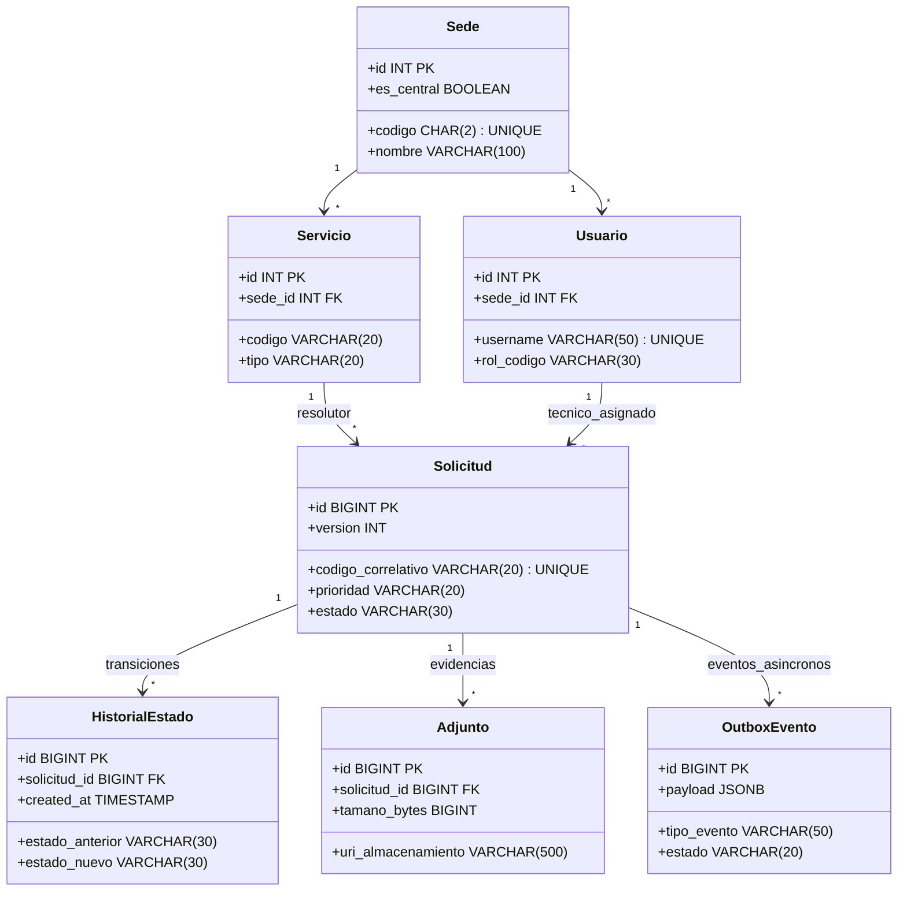

# Paso 01 — Lectura y Trazabilidad de Requisitos de Datos

**Workflow:** `02_database_workflow` — Ingeniería de base de datos  
**Skill utilizado:** `database-schema-designer` (instalado en `.agents/skills/`)  
**Proyecto:** Sistema de Seguimiento de Solicitudes Internas Hospitalarias (S3IH / Red Hospitalaria)  
**Fecha:** 2026-10-07  
**Restricción obligatoria de esta fase:** No crear SQL todavía. Establecer exclusivamente la trazabilidad formal Requisitos $\rightarrow$ Necesidades de Persistencia y Modelo de Datos.  

---

## 1. Fuentes Consultadas y Regla de Verdad

| Dimensión | Archivos de Entrada Vinculantes |
| :--- | :--- |
| **Contexto y Alcance** | `proyecto/00_contexto/descripcion.md`, `alcance.md`, `reglas_negocio.md`, `restricciones.md` |
| **Requisitos Formales** | `proyecto/01_requisitos/RF.md`, `RNF.md`, `criterios_aceptacion.md` |
| **Configuración Operativa** | `proyecto/02_configuracion/perfil_carga.yaml` |
| **Resultados de Arquitectura** | `proyecto/03_resultados/04_database_analysis.md`, `08_recomendacion_final.md` |
| **Decisiones Vigentes** | `proyecto/04_decisiones/decisiones_base_datos.md`, `decisiones_alcance.md`, `decisiones_api.md` |

### Regla de Resolución de Conflictos:
- Las decisiones consolidadas en [`decisiones_base_datos.md`](file:///d:/mod3proyectoclone/MAESTRIA_EN_INGENIERIA_DE_SOFTWARE_Y_SISTEMAS_INFORMATICO/MODULO_3_DESARROLLO_AL_LADO_DEL_CLIENTE_Y_SERVIDOR_WEB/architecture-skills-framework/proyecto/04_decisiones/decisiones_base_datos.md) y en el **ADR-001** (`08_recomendacion_final.md`) son de cumplimiento obligatorio:
  1. Base de datos relacional transaccional ACID (**PostgreSQL 16+** como motor recomendado / **MySQL 8.x InnoDB** como opción compatible).
  2. Control de concurrencia optimista con columna `version INT NOT NULL DEFAULT 1`.
  3. Prohibición absoluta de borrado físico (`REVOKE DELETE` general y tablas append-only para auditoría e historial de estados).
  4. Patrón *Transactional Outbox* para el desacoplamiento asíncrono de eventos de SLA y notificaciones.
  5. Desacoplamiento total de evidencias técnicas (hasta 5 MB) fuera de la base de datos relacional (prohibición de tipos BLOB en tablas operativas).

---

## 2. Inventario de Requisitos Funcionales $\rightarrow$ Entidades y Estructuras de Datos

### 2.1 Módulo 1: Identidad, Sedes y Servicios Hospitalarios
| Requisito | Descripción | Entidades y Estructuras Derivadas del Modelo |
| :--- | :--- | :--- |
| **RF-001** | Administrar estructura multisede de hasta 4 hospitales | `sedes` (`id`, `codigo_institucional CHAR(2)`, `nombre`, `direccion`, `telefono`, `es_central BOOLEAN`, `estado`). |
| **RF-002** | Catálogo de servicios y ubicaciones clínicas/técnicas por sede | `servicios` (`id`, `sede_id`, `codigo`, `nombre`, `tipo_servicio ENUM('ASISTENCIAL','RESOLUTOR')`, `ubicacion_piso_area`, `estado`). |
| **RF-003** | Usuarios, roles y asignación bajo mínimo privilegio (RBAC) | `usuarios` (`id`, `username`, `email`, `nombre_completo`, `sede_id`, `servicio_id`, `rol_codigo`, `estado`), `roles` (`codigo`, `nombre`, `permisos JSONB`). |
| **RF-004** | Cuadrillas técnicas, equipos de guardia y turnos activos | `cuadrillas_guardia` (`id`, `sede_id`, `servicio_resolutor_id`, `nombre`, `turno_codigo`, `estado`), `cuadrilla_miembros` (`cuadrilla_id`, `usuario_id`). |

### 2.2 Módulo 2: Catálogo de Solicitudes y Acuerdos de Nivel de Servicio (SLA)
| Requisito | Descripción | Entidades y Estructuras Derivadas del Modelo |
| :--- | :--- | :--- |
| **RF-010** | Catálogo tipificado de solicitudes internas por especialidad | `solicitudes_tipos` (`id`, `servicio_resolutor_id`, `codigo_tipo`, `nombre`, `descripcion`, `prioridad_sugerida`, `estado`). |
| **RF-011 / RF-012** | Prioridades asistenciales y tiempos límite SLA (MTTA y MTTR) | `sla_politicas` (`id`, `tipo_solicitud_id`, `prioridad_asistencial ENUM('VITAL','ALTA','MEDIA','BAJA')`, `tiempo_max_respuesta_mtta_min`, `tiempo_max_resolucion_mttr_min`). |
| **RF-013** | Calendarios operativos diferenciados (Continuo 24/7 vs. Hábil) | `sla_calendarios` (`codigo_calendario ENUM('CONTINUO_24_7','HABIL_ADMINISTRATIVO')`, `hora_inicio TIME`, `hora_fin TIME`, `dias_laborales_semana INT[]`), `dias_inhabiles_feriados` (`fecha DATE`, `sede_id NULL`). |
| **RF-014** | Causales estandarizadas de suspensión, rechazo y reapertura | `causales_catalogo` (`codigo`, `tipo_causal ENUM('SUSPENSION_ESPERA','RECHAZO_TECNICO','CANCELACION_USUARIO','REAPERTURA')`, `descripcion`, `estado`). |

### 2.3 Módulo 3: Radicación y Registro de Solicitudes
| Requisito | Descripción | Entidades y Estructuras Derivadas del Modelo |
| :--- | :--- | :--- |
| **RF-020** | Radicación formal con código correlativo inmutable (`H1-2026-XXXXXX`) | `solicitudes` (`id`, `codigo_correlativo VARCHAR(20) UNIQUE`, `sede_id`, `servicio_origen_id`, `servicio_resolutor_id`, `tipo_solicitud_id`, `ubicacion_especifica`, `prioridad_asistencial`, `descripcion_falla`, `estado`, `created_at`). |
| **RF-021** | Formulario expedito para emergencias de soporte vital | Soportado en `solicitudes` con bandera `es_expedita BOOLEAN DEFAULT FALSE` y validación de campos obligatorios mínimos (RN-002). |
| **RF-022** | Adjuntos y evidencias técnicas ($\le 5\text{ MB}$, máx. 5 archivos) | `solicitudes_adjuntos` (`id`, `solicitud_id`, `nombre_archivo_original`, `nombre_archivo_almacenado UUID`, `tipo_mime`, `extension`, `tamano_bytes CHECK <= 5242880`, `hash_sha256`, `uri_almacenamiento`, `usuario_id`, `created_at`). Cero BLOBs en BD. |
| **RF-023** | Idempotencia en radicación y cambios de estado (RN-011) | `transacciones_idempotencia` (`idempotency_key UUID PRIMARY KEY`, `usuario_id`, `request_hash VARCHAR(64)`, `response_status`, `response_body JSONB`, `created_at`, `expires_at`). |
| **RF-024** | Confirmación de radicación y cómputo de plazos estimados | Campos en `solicitudes`: `fecha_compromiso_mtta TIMESTAMP`, `fecha_compromiso_mttr TIMESTAMP`. |

### 2.4 Módulo 4: Asignación y Gestión de Responsables
| Requisito | Descripción | Entidades y Estructuras Derivadas del Modelo |
| :--- | :--- | :--- |
| **RF-030** | Asignación a técnico individual o cuadrilla de guardia | Campos en `solicitudes`: `tecnico_asignado_id REFERENCES usuarios(id)`, `cuadrilla_asignada_id REFERENCES cuadrillas_guardia(id)`, `fecha_asignacion TIMESTAMP`. |
| **RF-031** | Reasignación justificada entre técnicos o turnos | `solicitudes_reasignaciones` (`id`, `solicitud_id`, `tecnico_anterior_id`, `tecnico_nuevo_id`, `motivo_reasignacion TEXT`, `usuario_autorizador_id`, `created_at`). |
| **RF-032 / RF-033** | Notificaciones inmediatas de asignación a técnicos y solicitante | Generación de evento en `outbox_eventos` dentro de la transacción de asignación. |

### 2.5 Módulo 5: Ciclo de Vida y Máquina de Estados Finita Determinista
| Requisito | Descripción | Entidades y Estructuras Derivadas del Modelo |
| :--- | :--- | :--- |
| **RF-040 / RF-041** | Control estricto de transiciones de estado (RN-005) | `solicitudes_historial_estados` (append-only: `id`, `solicitud_id`, `estado_anterior`, `estado_nuevo`, `causal_codigo`, `motivo_texto`, `usuario_id`, `ip_origen`, `created_at UTC`). |
| **RF-043** | Transición a 'En Espera' con pausa del reloj de SLA (RN-006) | Campos en `solicitudes`: `sla_pausado BOOLEAN DEFAULT FALSE`, `sla_pausado_en TIMESTAMP`, `sla_segundos_pausados_acumulados INT DEFAULT 0`, `fecha_tentativa_reanudacion DATE`. |
| **RF-044** | Informe técnico obligatorio previo a 'Atendida' (RN-007) | `solicitudes_informes_atencion` (`solicitud_id PRIMARY KEY`, `diagnostico_falla TEXT`, `acciones_ejecutadas TEXT`, `tiempo_real_minutos INT`, `condicion_final_activo VARCHAR(100)`, `repuestos_utilizados JSONB`, `created_at`). |
| **RF-045 / RF-046** | Rechazo técnico y cancelación con justificación $\ge 20$ car. (RN-009) | Constraint de longitud en campo `motivo_texto CHECK (length(motivo_texto) >= 20)` al transicionar a `Rechazada` o `Cancelada`. |
| **RF-047** | Reapertura justificada en ventana estricta $\le 48\text{ horas}$ (RN-010) | `solicitudes_reaperturas` (`id`, `solicitud_id`, `motivo_inconformidad TEXT`, `usuario_solicitante_id`, `created_at`). Validación temporal `created_at <= (fecha_atencion + INTERVAL '48 hours')`. |

### 2.6 Módulo 6: Control Temporal, Alertas y Escalamiento
| Requisito | Descripción | Entidades y Estructuras Derivadas del Modelo |
| :--- | :--- | :--- |
| **RF-050** | Estampa temporal de servidor UTC en hitos del ciclo de vida | Campos en `solicitudes`: `fecha_radicacion_utc`, `fecha_asignacion_utc`, `fecha_inicio_proceso_utc`, `fecha_atencion_utc`, `fecha_cierre_utc`. |
| **RF-051** | Cálculo dinámico de SLA dual | Campos en `solicitudes`: `sla_calendario_tipo`, `sla_limite_resolucion_utc`, `sla_tiempo_consumido_segundos`. |
| **RF-052 / RF-053** | Alerta preventiva al 75% y escalamiento jerárquico al 100% | `outbox_eventos` (`id`, `tipo_evento ENUM('ALERTA_SLA_75','ESCALAMIENTO_SLA_100','NOTIF_CORREO')`, `agregado_tipo`, `agregado_id`, `payload JSONB`, `estado`, `created_at`, `scheduled_at`). |

### 2.7 Módulo 7: Bitácora, Búsqueda y Consultas Operativas
| Requisito | Descripción | Entidades y Estructuras Derivadas del Modelo |
| :--- | :--- | :--- |
| **RF-060** | Bitácora cronológica inmutable de notas técnicas y seguimiento | `solicitudes_bitacora` (`id`, `solicitud_id`, `tipo_entrada ENUM('NOTA_TECNICA','CAMBIO_GUARDIA','PIEZA_SOLICITADA','COMUNICACION')`, `contenido TEXT`, `usuario_id`, `ip_origen`, `created_at UTC`). |
| **RF-061 / RF-062** | Filtrado multicriterio y bandejas de trabajo personalizadas | Índices compuestos b-tree sobre `(sede_id, estado, prioridad_asistencial, created_at DESC)` y `(tecnico_asignado_id, estado)`. |

### 2.8 Módulo 8: Indicadores de Gestión y Auditoría Inmutable
| Requisito | Descripción | Entidades y Estructuras Derivadas del Modelo |
| :--- | :--- | :--- |
| **RF-070 / RF-071** | Tableros de calidad, exportación de reportes y agregados | Vistas de cálculo de MTTA/MTTR y agregaciones temporales procesadas sobre réplica de lectura. |
| **RF-072 / RN-013** | Pista de auditoría inmutable de todas las operaciones (No Repudio) | `auditoria_eventos` (append-only: `id`, `usuario_id`, `ip_origen`, `accion VARCHAR(50)`, `tabla_afectada`, `registro_id`, `datos_anteriores JSONB`, `datos_nuevos JSONB`, `hash_encadenado SHA256`, `created_at UTC`). |

---

## 3. Trazabilidad de Requisitos No Funcionales (RNF) $\rightarrow$ Restricciones Físicas

| RNF | Exigencia sobre la Base de Datos | Solución Prevista en el Diseño de Persistencia |
| :--- | :--- | :--- |
| **RNF-001** | Latencia de consulta en bandejas $p95 \le 400\text{ ms}$ | Índices compuestos especializados por sede, estado y prioridad asistencial. |
| **RNF-002** | Latencia de detalle con historial $p95 \le 500\text{ ms}$ | Claves foráneas indexadas (`idx_historial_solicitud`, `idx_adjuntos_solicitud`) sin escaneos completos. |
| **RNF-003** | Latencia de escritura transaccional $p95 \le 800\text{ ms}$ | Transacciones ACID compactas; transiciones de estado en $\le 3$ sentencias SQL preparadas con commit rápido. |
| **RNF-004** | Subida y validación de evidencias $\le 2.000\text{ ms}$ | Solo registro de metadatos en BD ($\approx 300\text{ bytes}$); almacenamiento físico desacoplado en NAS/NFS. |
| **RNF-010 / 011** | $3.000\text{ tx/h}$ nominal, picos de $9.000\text{ tx/h}$ ($\approx 2.5\text{ tx/s}$) | Pool de conexiones dimensionado (50 a 100 conexiones activas); buffer pool ajustado en memoria. |
| **RNF-012** | 700 usuarios concurrentes simultáneos | Concurrencia optimista con columna `version INT` que previene retención de bloqueos pesimistas. |
| **RNF-013** | Retención histórica $\ge 5\text{ años}$ ($\ge 1.500.000\text{ solicitudes}$) | Tipos enteros y UUIDs compactos; volumen estimado $\approx 2\text{ GB}$; preparado para particionamiento por año. |
| **RNF-021** | Viabilidad comprobada en escenario 10x ($30.000\text{ tx/h}$) | A $8.33\text{ tx/s}$, el motor relacional opera a $< 2\%$ de su capacidad de saturación transaccional. |
| **RNF-022** | Crecimiento multisede (hasta 4 hospitales) | Clave de sede (`sede_id`) en todas las entidades transaccionales; índices particionables por sede. |
| **RNF-031** | Principio de mínimo privilegio a nivel de base de datos | Usuario exclusivo `s3ih_app_user` con `REVOKE DELETE` general y `REVOKE UPDATE, DELETE` en tablas append-only. |
| **RNF-035** | Aislamiento y política Zero-PHI | Esquema sin tablas ni columnas para nombres de pacientes, historias clínicas ni diagnósticos médicos. |
| **RNF-040** | Disponibilidad continua 24/7 en soporte vital | Réplica en caliente (*Hot Standby*) con streaming WAL hacia el Hospital 2. |
| **RNF-050 / 051** | Metas de recuperación: RPO $\le 60\text{ min}$, RTO $\le 180\text{ min}$ | Respaldos diarios completos + archivado continuo de WAL cada 15 min $\rightarrow$ **RPO $< 15\text{ min}$**, **RTO $< 30\text{ min}$**. |
| **RNF-070 / 072** | Observabilidad y Correlation ID | Columna `correlation_id UUID NULL` en las tablas `auditoria_eventos` y `outbox_eventos`. |

---

## 4. Matriz de Entidades Candidatas y Reglas de Integridad

### Reglas de Integridad Inviolables:
1. **Unicidad de Correlativo:** `codigo_correlativo` debe ser inmutable y generado atómicamente por sede y año (`H1-2026-000452`).
2. **Máquina de Estados Restringida:** Transiciones validadas contra matriz de estados (RN-005).
3. **Causal Obligatoria:** Cancelaciones y rechazos exigen justificación $\ge 20$ caracteres.
4. **Informe de Atención Obligatorio:** Toda transición a `Atendida` o `Cerrada` exige la preexistencia del registro en `solicitudes_informes_atencion` (RN-007).
5. **Cuota de Evidencias:** Archivos adjuntos estrictamente $\le 5\text{ MB}$ ($5.242.880\text{ bytes}$) y máximo 5 archivos por requerimiento.

---

## 5. Conclusión y Traspaso de Etapa

El **Paso 01** establece de forma exhaustiva y verificable la trazabilidad entre los 72 requisitos funcionales, 82 requisitos no funcionales, 13 reglas de negocio y las futuras entidades y restricciones de la base de datos de S3IH, sin haber adelantado sentencias SQL prematuras.

El siguiente paso obligatorio del workflow corresponde a:
> **Paso 02 — Modelo Conceptual (`02_modelo_conceptual/modelo_conceptual.md`):**  
> Definir formalmente las entidades, relaciones, cardinalidades, atributos conceptuales y reglas de negocio del dominio hospitalario S3IH utilizando el skill `database-schema-designer`.
