# Paso 03 — Diagrama Entidad-Relación (Mermaid)

**Workflow:** `02_database_workflow` — Paso 03  
**Skill utilizado:** `database-schema-designer` (instalado en `.agents/skills/`)  
**Proyecto:** Sistema de Seguimiento de Solicitudes Internas Hospitalarias (S3IH / Red de 4 hospitales)  
**Entrada:** `02_modelo_conceptual/modelo_conceptual.md`, `01_requisitos_datos/requisitos_datos.md`  
**Restricción de esta fase:** Sin sintaxis DDL SQL ni tipos específicos de motor. Diagrama conceptual visual versionable en Mermaid que formaliza entidades, relaciones y cardinalidades.  

---

## 1. Diagrama Entidad-Relación Global (Mermaid ERD)

```mermaid
erDiagram
    %% ==========================================
    %% DOMINIO 1: ORGANIZACIÓN Y MULTISEDE
    %% ==========================================
    SedeHospitalaria ||--o{ ServicioHospitalario : alberga
    SedeHospitalaria ||--o{ Usuario : adscribe
    SedeHospitalaria ||--o{ Solicitud : centraliza
    Rol ||--o{ Usuario : asigna_perfil

    ServicioHospitalario ||--o{ CuadrillaGuardia : organiza
    ServicioHospitalario ||--o{ CatalogoSolicitudTipo : tipifica
    ServicioHospitalario ||--o{ Solicitud : solicita_origen
    ServicioHospitalario ||--o{ Solicitud : resuelve_destino

    CuadrillaGuardia ||--o{ CuadrillaMiembro : compone
    Usuario ||--o{ CuadrillaMiembro : participa

    %% ==========================================
    %% DOMINIO 2: POLÍTICAS DE SLA Y CATÁLOGOS
    %% ==========================================
    CatalogoSolicitudTipo ||--o{ PoliticaSLA : define_plazos
    CatalogoSolicitudTipo ||--o{ Solicitud : clasifica
    CalendarioSLA ||--o{ PoliticaSLA : rige_horario
    CausalEstandarizada ||--o{ HistorialEstadoSolicitud : categoriza_causal
    CausalEstandarizada ||--o{ Solicitud : estado_espera_causal

    %% ==========================================
    %% DOMINIO 3: NÚCLEO TRANSACCIONAL DE SOLICITUDES
    %% ==========================================
    Usuario ||--o{ Solicitud : radica_solicitante
    Usuario ||--o{ Solicitud : asignado_tecnico
    CuadrillaGuardia ||--o{ Solicitud : asignada_cuadrilla

    Solicitud ||--|| ControlTiempoSLA : computa_plazos
    Solicitud ||--o{ HistorialEstadoSolicitud : registra_transicion
    Solicitud ||--o| InformeAtencionTecnica : certifica_cierre
    Solicitud ||--o{ EvidenciaAdjunta : anexa_archivos
    Solicitud ||--o{ BitacoraNotaTecnica : cronologia_notas
    Solicitud ||--o{ ReasignacionSolicitud : audita_reasignacion
    Solicitud ||--o{ ReaperturaSolicitud : gestiona_reapertura
    Solicitud ||--o{ EventoOutbox : emite_asincrono

    %% ==========================================
    %% DOMINIO 4: AUDITORÍA Y TRAZABILIDAD
    %% ==========================================
    Usuario ||--o{ HistorialEstadoSolicitud : ejecuta_transicion
    Usuario ||--o{ InformeAtencionTecnica : suscribe_informe
    Usuario ||--o{ ReaperturaSolicitud : radica_inconformidad
    Usuario ||--o{ EvidenciaAdjunta : sube_evidencia
    Usuario ||--o{ BitacoraNotaTecnica : escribe_nota
    Usuario ||--o{ ReasignacionSolicitud : autoriza_cambio
    Usuario ||--o{ TransaccionIdempotencia : emite_token
    Usuario ||--o{ AuditoriaEvento : genera_pista

    %% ==========================================
    %% DEFINICIÓN DE ENTIDADES Y ATRIBUTOS CONCEPTUALES
    %% ==========================================
    SedeHospitalaria {
        int id
        string codigo_institucional
        string nombre
        boolean es_central
        string estado
    }

    ServicioHospitalario {
        int id
        int sede_id
        string codigo
        string nombre
        string tipo_asistencial_o_resolutor
        string ubicacion_piso_area
    }

    Usuario {
        int id
        string username_ldap
        string email_corporativo
        string nombre_completo
        int sede_id
        int servicio_id
        string rol_codigo
        string estado
    }

    Rol {
        string codigo
        string nombre
        string permisos_json
    }

    CuadrillaGuardia {
        int id
        int sede_id
        int servicio_resolutor_id
        string nombre
        string turno_activo
    }

    CuadrillaMiembro {
        int cuadrilla_id
        int usuario_id
    }

    CatalogoSolicitudTipo {
        int id
        int servicio_resolutor_id
        string codigo_tipo
        string nombre
        string prioridad_sugerida
    }

    PoliticaSLA {
        int id
        int tipo_solicitud_id
        string prioridad_asistencial
        int mtta_minutos
        int mttr_minutos
        string calendario_codigo
    }

    CalendarioSLA {
        string codigo_calendario
        time hora_inicio
        time hora_fin
        string dias_laborales
    }

    CausalEstandarizada {
        string codigo
        string tipo_causal
        string descripcion
    }

    Solicitud {
        bigint id
        string codigo_correlativo_inmutable
        int sede_id
        int servicio_solicitante_id
        int servicio_resolutor_id
        int tipo_solicitud_id
        string ubicacion_especifica
        string prioridad_asistencial
        string descripcion_falla_zero_phi
        string estado_actual
        boolean es_expedita
        int usuario_solicitante_id
        int tecnico_asignado_id
        int cuadrilla_asignada_id
        int version_concurrencia
        timestamp fecha_radicacion_utc
    }

    ControlTiempoSLA {
        bigint solicitud_id
        string calendario_codigo
        timestamp fecha_limite_mtta_utc
        timestamp fecha_limite_mttr_utc
        int segundos_consumidos
        boolean esta_pausado
        timestamp fecha_ultima_pausa_utc
        int segundos_pausados_acumulados
        date fecha_tentativa_reanudacion
        boolean alerta_75_emitida
        boolean escalamiento_100_emitido
    }

    HistorialEstadoSolicitud {
        bigint id
        bigint solicitud_id
        string estado_anterior
        string estado_nuevo
        string causal_codigo
        string motivo_texto
        int usuario_id
        string ip_origen
        timestamp created_at_utc
    }

    InformeAtencionTecnica {
        bigint solicitud_id
        string diagnostico_falla
        string acciones_ejecutadas
        int tiempo_real_minutos
        string condicion_final_activo
        string repuestos_utilizados_json
        int tecnico_responsable_id
        timestamp created_at_utc
    }

    ReaperturaSolicitud {
        bigint id
        bigint solicitud_id
        string motivo_inconformidad
        int usuario_solicitante_id
        timestamp created_at_utc
    }

    EvidenciaAdjunta {
        bigint id
        bigint solicitud_id
        string nombre_archivo_original
        string uuid_almacenamiento
        string tipo_mime_real
        string extension
        bigint tamano_bytes
        string hash_sha256
        string uri_almacenamiento_desacoplado
        int usuario_id
        timestamp created_at_utc
    }

    BitacoraNotaTecnica {
        bigint id
        bigint solicitud_id
        string tipo_entrada
        string contenido
        int usuario_id
        string ip_origen
        timestamp created_at_utc
    }

    ReasignacionSolicitud {
        bigint id
        bigint solicitud_id
        int tecnico_anterior_id
        int tecnico_nuevo_id
        string motivo
        int usuario_autorizador_id
        timestamp created_at_utc
    }

    TransaccionIdempotencia {
        uuid idempotency_key
        int usuario_id
        string request_hash_sha256
        int response_status_http
        string response_body_json
        timestamp created_at_utc
        timestamp expires_at_utc
    }

    EventoOutbox {
        bigint id
        string tipo_evento
        string agregado_tipo
        bigint agregado_id
        string payload_json
        string estado
        timestamp created_at_utc
        timestamp scheduled_at_utc
    }

    AuditoriaEvento {
        bigint id
        int usuario_id
        string ip_origen
        string accion
        string tabla_afectada
        bigint registro_id
        string datos_anteriores_json
        string datos_nuevos_json
        string hash_encadenado_sha256
        timestamp created_at_utc
    }
```

---

## 2. Matriz de Cardinalidades y Reglas Estructurales

| Relación | Cardinalidad | Justificación Estructural de Dominio | Regla de Negocio Asociada |
| :--- | :---: | :--- | :--- |
| **Sede $\rightarrow$ Servicios** | $1 : N$ | Un hospital cuenta con múltiples áreas asistenciales y técnicas. | RF-001, RF-002 |
| **Sede $\rightarrow$ Solicitudes** | $1 : N$ | Cada sede origina y gestiona sus propias solicitudes de forma inmutable. | RN-001 (Correlativo por sede) |
| **Servicio Solicitante $\rightarrow$ Solicitud** | $1 : N$ | Un servicio clínico genera múltiples requerimientos de soporte. | RN-002 (Datos mínimos) |
| **Servicio Resolutor $\rightarrow$ Solicitud** | $1 : N$ | Un área técnica competente (ej. Biomédico) atiende múltiples órdenes. | RN-003 (Asignación obligatoria) |
| **Cuadrilla $\rightarrow$ Miembros $\rightarrow$ Usuario** | $N : M$ | Técnicos resolutores rotan en cuadrillas de guardia 24/7. | RF-004 (Guardias activas) |
| **Tipo Solicitud $\rightarrow$ SLA Política** | $1 : N$ | Un tipo de falla tiene plazos diferenciados según la prioridad asistencial. | RF-011, RF-012 |
| **Solicitud $\rightarrow$ ControlTiempoSLA** | $1 : 1$ | Cada solicitud tiene exactamente un motor de seguimiento temporal. | RF-051 (Cálculo SLA dual) |
| **Solicitud $\rightarrow$ Historial Estados** | $1 : N$ | Cada transición queda grabada inalterablemente (*append-only*). | RN-005, RN-012, RN-013 |
| **Solicitud $\rightarrow$ Informe Atención** | $1 : 0..1$ | Exactamente un informe técnico por solicitud resuelta (obligatorio). | RN-007 (Precondición de cierre) |
| **Solicitud $\rightarrow$ Evidencias Adjuntas** | $1 : 0..5$ | Entre cero y un máximo de 5 archivos ($\le 5\text{ MB}$) desacoplados. | RF-022, Restricción Técnica 5 |
| **Solicitud $\rightarrow$ Reaperturas** | $1 : 0..N$ | Reaperturas excepcionales dentro de la ventana de 48 horas. | RN-010 (Ventana de 48h) |
| **Solicitud $\rightarrow$ Bitácora** | $1 : N$ | Notas técnicas de seguimiento cronológico inmutables. | RF-060 |
| **Solicitud $\rightarrow$ Eventos Outbox** | $1 : N$ | Notificaciones y alertas de SLA procesadas de forma asíncrona. | RNF-041, D-06 |

---

## 3. Verificación de Cumplimiento de Principios de Datos

1. **Integridad Referencial Estricta:**
   - Toda solicitud está obligatoriamente vinculada a una sede, un servicio de origen y un servicio de destino válidos.
   - No existen entidades huérfanas en el ciclo de vida.
2. **Inmutabilidad y No Repudio (RN-012, RN-013):**
   - Las entidades `HistorialEstadoSolicitud`, `BitacoraNotaTecnica` y `AuditoriaEvento` son de naturaleza estrictamente **append-only** (sin relaciones destructivas).
3. **Concurrencia Optimista (D-01, CA-004):**
   - La entidad `Solicitud` incorpora el atributo conceptual `version_concurrencia` que garantiza control atómico en cambios de guardia.
4. **Almacenamiento Desacoplado (Restricción Técnica 5, D-04):**
   - La entidad `EvidenciaAdjunta` almacena metadatos y la URI del almacenamiento desacoplado, sin contener atributos de datos binarios (cero BLOBs en tablas transaccionales).
5. **Aislamiento Zero-PHI (RNF-035):**
   - El modelo carece por completo de entidades o atributos vinculados a pacientes o registros clínicos.

---

## 4. Conclusión y Traspaso de Etapa

El diagrama Entidad-Relación visualiza formalmente la arquitectura de datos del **Sistema S3IH**, asegurando consistencia entre entidades, relaciones y reglas de negocio.

El siguiente paso obligatorio corresponde a:
> **Paso 04 — Modelo Lógico (`03_modelo_logico/modelo_logico.md`):**  
> Transformar el modelo conceptual en tablas relacionales, columnas formales, claves primarias y foráneas, tipos lógicos independientes de motor, cardinalidades y restricciones de unicidad e integridad relacional.
