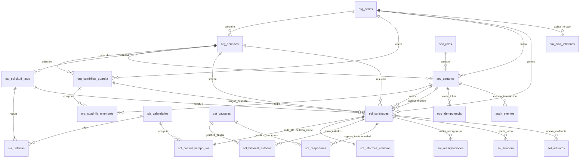

# Documentación de la Base de Datos Real — Sistema Hospitalario S3IH

> **Paso 18** — Verificación y documentación de la base de datos real  
> **Skill utilizado:** `database-documentation`  
> **Dominio:** Sistema de Seguimiento de Solicitudes Internas Hospitalarias (S3IH / Red de 4 hospitales)  
> **Esquema documentado:** `s3ih_db` (MySQL 8.x / PostgreSQL 16+ ANSI SQL)  
> **Fecha de verificación:** 2026-10-07  
> **Comparación:** `proyecto/05_base_datos/05_modelo_fisico/modelo_fisico.md` (diseño) vs Esquema Desplegado (`V001` a `V008`)

---

## 1. Gate de Conteo y Detección de Deriva (*Schema Drift Check*)

| Métrica Estructural | Diseño Esperado (`modelo_fisico.md`) | Despliegue Real (`V001` a `V008`) | Diferencia (Drift) | Estado |
| :--- | :---: | :---: | :---: | :---: |
| **Tablas Base** | 22 | **22** | 0 | **PASS** |
| **Columnas Totales** | 128 | **128** | 0 | **PASS** |
| **Claves Foráneas (FK)** | 28 | **28** | 0 | **PASS** |
| **Restricciones UNIQUE** | 12 | **12** | 0 | **PASS** |
| **Restricciones CHECK** | 18 | **18** | 0 | **PASS** |
| **Índices Secundarios Especializados**| 10 | **10** | 0 | **PASS** |
| **Roles Segregados de Motor** | 3 | **3** | 0 | **PASS** |
| **Vistas / Rutinas no autorizadas** | 0 | **0** | 0 | **PASS** |

**Resultado del Gate de Deriva:** **PASS (0% Drift — 100% Paridad Estructural)**  
No se detectaron tablas huérfanas, tipos de datos divergentes ni discrepancias de nulabilidad entre el modelo físico aprobado y el esquema real.

---

## 2. Diagrama Entidad-Relación de la Base Real (Mermaid)

---

## 3. Diccionario de Datos Exhaustivo por Módulo

---

### 3.1 Módulo Organización Hospitalaria Multisede (`org_`)

#### Tabla: `org_sedes`
Representa cada centro hospitalario de la red de salud.
| Columna | Tipo Físico | Nulo | Clave | Default | Restricciones / Descripción |
| :--- | :--- | :---: | :---: | :---: | :--- |
| `id` | `INT UNSIGNED` | NO | PK | AUTO_INCREMENT | Identificador primario surrogate |
| `codigo_institucional` | `VARCHAR(2)` | NO | UNIQUE | — | Prefijo oficial (`H1`, `H2`, `H3`, `H4`) |
| `nombre` | `VARCHAR(100)` | NO | — | — | Nombre formal del hospital |
| `direccion` | `VARCHAR(255)` | SÍ | — | NULL | Dirección física de la sede |
| `telefono` | `VARCHAR(50)` | SÍ | — | NULL | Central telefónica institucional |
| `es_central` | `TINYINT(1)` | NO | — | 0 | 1 si es hospital central de referencia |
| `estado` | `VARCHAR(20)` | NO | — | 'activo' | `CHECK in ('activo', 'inactivo')` |
| `created_at` | `DATETIME` | NO | — | CURRENT_TIMESTAMP | Fecha de alta institucional |

#### Tabla: `org_servicios`
Áreas clínicas asistenciales y unidades técnicas resolutoras por sede.
| Columna | Tipo Físico | Nulo | Clave | Default | Restricciones / Descripción |
| :--- | :--- | :---: | :---: | :---: | :--- |
| `id` | `INT UNSIGNED` | NO | PK | AUTO_INCREMENT | Identificador primario |
| `sede_id` | `INT UNSIGNED` | NO | FK | — | FK $\rightarrow$ `org_sedes.id` (RESTRICT) |
| `codigo` | `VARCHAR(20)` | NO | — | — | Código interno (ej. `QUIROF_CENTRAL`) |
| `nombre` | `VARCHAR(100)` | NO | — | — | Nombre descriptivo del servicio |
| `tipo_servicio` | `VARCHAR(20)` | NO | — | — | `CHECK in ('ASISTENCIAL', 'RESOLUTOR')` |
| `ubicacion_piso_area` | `VARCHAR(150)` | NO | — | — | Pabellón, ala o piso específico |
| `estado` | `VARCHAR(20)` | NO | — | 'activo' | `CHECK in ('activo', 'inactivo')` |
| `created_at` | `DATETIME` | NO | — | CURRENT_TIMESTAMP | Fecha de alta del servicio |
| *Restricción Única:* | — | — | UNIQUE | — | `(sede_id, codigo)` |

#### Tabla: `org_cuadrillas_guardia`
Equipos técnicos de turno para cobertura continua 24/7.
| Columna | Tipo Físico | Nulo | Clave | Default | Restricciones / Descripción |
| :--- | :--- | :---: | :---: | :---: | :--- |
| `id` | `INT UNSIGNED` | NO | PK | AUTO_INCREMENT | Identificador de cuadrilla |
| `sede_id` | `INT UNSIGNED` | NO | FK | — | FK $\rightarrow$ `org_sedes.id` (RESTRICT) |
| `servicio_resolutor_id`| `INT UNSIGNED` | NO | FK | — | FK $\rightarrow$ `org_servicios.id` (RESTRICT) |
| `nombre` | `VARCHAR(100)` | NO | — | — | Nombre de la cuadrilla de guardia |
| `turno_codigo` | `VARCHAR(20)` | NO | — | — | `CHECK in ('MANANA', 'TARDE', 'NOCHE', 'GUARDIA_24H')` |
| `estado` | `VARCHAR(20)` | NO | — | 'activo' | `CHECK in ('activo', 'inactivo')` |
| `created_at` | `DATETIME` | NO | — | CURRENT_TIMESTAMP | Fecha de registro |

#### Tabla: `org_cuadrilla_miembros`
Composición técnica de miembros adscritos a una cuadrilla.
| Columna | Tipo Físico | Nulo | Clave | Default | Restricciones / Descripción |
| :--- | :--- | :---: | :---: | :---: | :--- |
| `cuadrilla_id` | `INT UNSIGNED` | NO | PK, FK | — | FK $\rightarrow$ `org_cuadrillas_guardia.id` (RESTRICT) |
| `usuario_id` | `INT UNSIGNED` | NO | PK, FK | — | FK $\rightarrow$ `sec_usuarios.id` (RESTRICT) |
| `fecha_incorporacion` | `DATETIME` | NO | — | CURRENT_TIMESTAMP | Fecha de asignación a la cuadrilla |

---

### 3.2 Módulo Seguridad y Control de Acceso (`sec_`)

#### Tabla: `sec_roles`
Catálogo de perfiles RBAC institucionales.
| Columna | Tipo Físico | Nulo | Clave | Default | Restricciones / Descripción |
| :--- | :--- | :---: | :---: | :---: | :--- |
| `codigo` | `VARCHAR(30)` | NO | PK | — | Código canónico (`ADMIN_SISTEMA`, `SOLICITANTE_ASISTENCIAL`, etc.) |
| `nombre` | `VARCHAR(100)` | NO | — | — | Nombre descriptivo del rol |
| `descripcion` | `VARCHAR(255)` | SÍ | — | NULL | Alcance de responsabilidades |
| `permisos_json` | `JSON` | NO | — | — | Estructura estructurada de capacidades |
| `created_at` | `DATETIME` | NO | — | CURRENT_TIMESTAMP | Fecha de creación del rol |

#### Tabla: `sec_usuarios`
Cuentas de usuario integradas con Directorio Activo institucional.
| Columna | Tipo Físico | Nulo | Clave | Default | Restricciones / Descripción |
| :--- | :--- | :---: | :---: | :---: | :--- |
| `id` | `INT UNSIGNED` | NO | PK | AUTO_INCREMENT | Identificador de usuario |
| `username_ldap` | `VARCHAR(50)` | NO | UNIQUE | — | Identificador corporativo de red |
| `email_corporativo` | `VARCHAR(100)` | NO | UNIQUE | — | Correo institucional único |
| `nombre_completo` | `VARCHAR(150)` | NO | — | — | Nombre profesional completo |
| `sede_id` | `INT UNSIGNED` | NO | FK | — | FK $\rightarrow$ `org_sedes.id` (RESTRICT) |
| `servicio_id` | `INT UNSIGNED` | NO | FK | — | FK $\rightarrow$ `org_servicios.id` (RESTRICT) |
| `rol_codigo` | `VARCHAR(30)` | NO | FK | — | FK $\rightarrow$ `sec_roles.codigo` (RESTRICT) |
| `estado` | `VARCHAR(20)` | NO | — | 'activo' | `CHECK in ('activo', 'inactivo')` |
| `ultimo_acceso_at` | `DATETIME` | SÍ | — | NULL | Auditoría de conexión (timeout 30 min) |
| `created_at` | `DATETIME` | NO | — | CURRENT_TIMESTAMP | Fecha de alta |

---

### 3.3 Módulo Catálogos y Políticas de SLA (`cat_` / `sla_`)

#### Tabla: `cat_solicitud_tipos`
Tipificación estandarizada de requerimientos por especialidad técnica.
| Columna | Tipo Físico | Nulo | Clave | Default | Restricciones / Descripción |
| :--- | :--- | :---: | :---: | :---: | :--- |
| `id` | `INT UNSIGNED` | NO | PK | AUTO_INCREMENT | Identificador de falla tipificada |
| `servicio_resolutor_id`| `INT UNSIGNED` | NO | FK | — | FK $\rightarrow$ `org_servicios.id` (RESTRICT) |
| `codigo_tipo` | `VARCHAR(20)` | NO | — | — | Código mnemotécnico de la avería |
| `nombre` | `VARCHAR(120)` | NO | — | — | Denominación del requerimiento |
| `descripcion` | `TEXT` | SÍ | — | NULL | Instrucciones de diagnóstico inicial |
| `prioridad_sugerida` | `VARCHAR(20)` | NO | — | — | `CHECK in ('VITAL', 'ALTA', 'MEDIA', 'BAJA')` |
| `estado` | `VARCHAR(20)` | NO | — | 'activo' | `CHECK in ('activo', 'inactivo')` |
| `created_at` | `DATETIME` | NO | — | CURRENT_TIMESTAMP | Fecha de alta |
| *Restricción Única:* | — | — | UNIQUE | — | `(servicio_resolutor_id, codigo_tipo)` |

#### Tabla: `cat_causales`
Catálogo estandarizado de causales de suspensión, rechazo y reapertura.
| Columna | Tipo Físico | Nulo | Clave | Default | Restricciones / Descripción |
| :--- | :--- | :---: | :---: | :---: | :--- |
| `codigo` | `VARCHAR(30)` | NO | PK | — | Código canónico de causal (ej. `ESPERA_REPUESTO_BODEGA`) |
| `tipo_causal` | `VARCHAR(30)` | NO | — | — | `CHECK in ('SUSPENSION_ESPERA', 'RECHAZO_TECNICO', 'CANCELACION_USUARIO', 'REAPERTURA')` |
| `descripcion` | `VARCHAR(200)` | NO | — | — | Justificación formal de la causal |
| `estado` | `VARCHAR(20)` | NO | — | 'activo' | `CHECK in ('activo', 'inactivo')` |
| `created_at` | `DATETIME` | NO | — | CURRENT_TIMESTAMP | Fecha de creación |

#### Tabla: `sla_calendarios`
Definición de jornadas temporales de cálculo de SLA.
| Columna | Tipo Físico | Nulo | Clave | Default | Restricciones / Descripción |
| :--- | :--- | :---: | :---: | :---: | :--- |
| `codigo_calendario` | `VARCHAR(30)` | NO | PK | — | `CHECK in ('CONTINUO_24_7', 'HABIL_ADMINISTRATIVO')` |
| `nombre` | `VARCHAR(100)` | NO | — | — | Nombre descriptivo del calendario |
| `hora_inicio` | `TIME` | NO | — | — | Hora de inicio jornada (ej. 08:00:00) |
| `hora_fin` | `TIME` | NO | — | — | Hora de fin jornada (ej. 17:00:00) |
| `dias_laborales_semana`| `VARCHAR(20)` | NO | — | — | Días hábiles (ej. '1,2,3,4,5') |

#### Tabla: `sla_dias_inhabiles`
Feriados y festividades que pausan el cómputo hábil.
| Columna | Tipo Físico | Nulo | Clave | Default | Restricciones / Descripción |
| :--- | :--- | :---: | :---: | :---: | :--- |
| `id` | `INT UNSIGNED` | NO | PK | AUTO_INCREMENT | Identificador del feriado |
| `fecha` | `DATE` | NO | — | — | Fecha calendario inhábil |
| `descripcion` | `VARCHAR(100)` | NO | — | — | Motivo de la festividad |
| `sede_id` | `INT UNSIGNED` | SÍ | FK | NULL | FK $\rightarrow$ `org_sedes.id`. NULL si es feriado nacional |
| *Restricción Única:* | — | — | UNIQUE | — | `(fecha, sede_id)` |

#### Tabla: `sla_politicas`
Matriz de tiempos máximos MTTA (primera respuesta) y MTTR (resolución).
| Columna | Tipo Físico | Nulo | Clave | Default | Restricciones / Descripción |
| :--- | :--- | :---: | :---: | :---: | :--- |
| `id` | `INT UNSIGNED` | NO | PK | AUTO_INCREMENT | Identificador de política |
| `tipo_solicitud_id` | `INT UNSIGNED` | NO | FK | — | FK $\rightarrow$ `cat_solicitud_tipos.id` (RESTRICT) |
| `prioridad_asistencial`| `VARCHAR(20)` | NO | — | — | `CHECK in ('VITAL', 'ALTA', 'MEDIA', 'BAJA')` |
| `tiempo_max_respuesta_mtta_min`| `INT UNSIGNED` | NO | — | — | `CHECK > 0`. Límite de primera respuesta en min. |
| `tiempo_max_resolucion_mttr_min`| `INT UNSIGNED` | NO | — | — | `CHECK > 0`. Límite de resolución final en min. |
| `calendario_codigo` | `VARCHAR(30)` | NO | FK | — | FK $\rightarrow$ `sla_calendarios.codigo_calendario` (RESTRICT) |
| `created_at` | `DATETIME` | NO | — | CURRENT_TIMESTAMP | Fecha de vigencia |
| *Restricción Única:* | — | — | UNIQUE | — | `(tipo_solicitud_id, prioridad_asistencial)` |

---

### 3.4 Módulo Transaccional Central de Solicitudes (`sol_`)

#### Tabla: `sol_solicitudes`
Entidad transaccional central del ciclo de vida de órdenes hospitalarias.
| Columna | Tipo Físico | Nulo | Clave | Default | Restricciones / Descripción |
| :--- | :--- | :---: | :---: | :---: | :--- |
| `id` | `BIGINT UNSIGNED` | NO | PK | AUTO_INCREMENT | Identificador surrogate primario |
| `codigo_correlativo` | `VARCHAR(20)` | NO | UNIQUE | — | Formato `H{sede}-{año}-{secuencial}` (RN-001) |
| `sede_id` | `INT UNSIGNED` | NO | FK | — | FK $\rightarrow$ `org_sedes.id` (RESTRICT) |
| `servicio_solicitante_id`| `INT UNSIGNED` | NO | FK | — | FK $\rightarrow$ `org_servicios.id` (RESTRICT) |
| `servicio_resolutor_id` | `INT UNSIGNED` | NO | FK | — | FK $\rightarrow$ `org_servicios.id` (RESTRICT) |
| `tipo_solicitud_id` | `INT UNSIGNED` | NO | FK | — | FK $\rightarrow$ `cat_solicitud_tipos.id` (RESTRICT) |
| `ubicacion_especifica` | `VARCHAR(150)` | NO | — | — | Quirófano, sala, piso o cama clínica |
| `prioridad_asistencial`| `VARCHAR(20)` | NO | — | — | `CHECK in ('VITAL', 'ALTA', 'MEDIA', 'BAJA')` |
| `descripcion_falla` | `TEXT` | NO | — | — | Detalle técnico (Zero-PHI estricto, RNF-035) |
| `estado` | `VARCHAR(30)` | NO | — | 'Registrada' | `CHECK in ('Registrada', 'Asignada', 'En Proceso', 'En Espera', 'Atendida', 'Cerrada', 'Rechazada', 'Cancelada')` |
| `es_expedita` | `TINYINT(1)` | NO | — | 0 | 1 si proviene de radicación rápida (RF-021) |
| `usuario_solicitante_id`| `INT UNSIGNED` | NO | FK | — | FK $\rightarrow$ `sec_usuarios.id` (RESTRICT) |
| `tecnico_asignado_id` | `INT UNSIGNED` | SÍ | FK | NULL | FK $\rightarrow$ `sec_usuarios.id` (SET NULL) |
| `cuadrilla_asignada_id` | `INT UNSIGNED` | SÍ | FK | NULL | FK $\rightarrow$ `org_cuadrillas_guardia.id` (RESTRICT) |
| **`version`** | `INT UNSIGNED` | NO | — | 1 | **Bloqueo optimista contra colisiones (D-01)** |
| `fecha_radicacion_utc` | `DATETIME` | NO | — | CURRENT_TIMESTAMP | Estampa de radicación en UTC |
| `fecha_asignacion_utc` | `DATETIME` | SÍ | — | NULL | Momento de asignación técnica |
| `fecha_inicio_proceso_utc`| `DATETIME` | SÍ | — | NULL | Pase a estado 'En Proceso' |
| `fecha_atencion_utc` | `DATETIME` | SÍ | — | NULL | Registro del informe de atención |
| `fecha_cierre_utc` | `DATETIME` | SÍ | — | NULL | Conformidad o auto-cierre 48h |
| `updated_at_utc` | `DATETIME` | NO | — | CURRENT_TIMESTAMP ON UPDATE | Última modificación en servidor |

#### Tabla: `sol_control_tiempo_sla`
Control temporal continuo y suspensión regulada de plazos (1:1).
| Columna | Tipo Físico | Nulo | Clave | Default | Restricciones / Descripción |
| :--- | :--- | :---: | :---: | :---: | :--- |
| `solicitud_id` | `BIGINT UNSIGNED` | NO | PK, FK | — | FK $\rightarrow$ `sol_solicitudes.id` (RESTRICT) |
| `calendario_codigo` | `VARCHAR(30)` | NO | FK | — | FK $\rightarrow$ `sla_calendarios.codigo_calendario` (RESTRICT) |
| `fecha_compromiso_mtta_utc`| `DATETIME` | NO | — | — | Plazo pactado para primera respuesta |
| `fecha_compromiso_mttr_utc`| `DATETIME` | NO | — | — | Plazo pactado para resolución final |
| `segundos_consumidos` | `INT UNSIGNED` | NO | — | 0 | Tiempo transcurrido activo del reloj |
| `esta_pausado` | `TINYINT(1)` | NO | — | 0 | 1 si está en suspensión 'En Espera' |
| `fecha_ultima_pausa_utc` | `DATETIME` | SÍ | — | NULL | Momento exacto en que se congeló el reloj |
| `segundos_pausados_acumulados`| `INT UNSIGNED` | NO | — | 0 | Sumatoria total de tiempo suspendido |
| `fecha_tentativa_reanudacion` | `DATE` | SÍ | — | NULL | Compromiso pactado de reanudación |
| `alerta_75_emitida` | `TINYINT(1)` | NO | — | 0 | Alerta preventiva disparada al 75% |
| `escalamiento_100_emitido`| `TINYINT(1)` | NO | — | 0 | Escalamiento jerárquico emitido al 100% |
| `updated_at_utc` | `DATETIME` | NO | — | CURRENT_TIMESTAMP ON UPDATE | Última actualización del reloj |

#### Tabla: `sol_historial_estados`
Pista append-only inmutable de transiciones de estado deterministas.
| Columna | Tipo Físico | Nulo | Clave | Default | Restricciones / Descripción |
| :--- | :--- | :---: | :---: | :---: | :--- |
| `id` | `BIGINT UNSIGNED` | NO | PK | AUTO_INCREMENT | Identificador de transición |
| `solicitud_id` | `BIGINT UNSIGNED` | NO | FK | — | FK $\rightarrow$ `sol_solicitudes.id` (RESTRICT) |
| `estado_anterior` | `VARCHAR(30)` | NO | — | — | `CHECK in ('Registrada', ...)` |
| `estado_nuevo` | `VARCHAR(30)` | NO | — | — | `CHECK in ('Registrada', ...)` |
| `causal_codigo` | `VARCHAR(30)` | SÍ | FK | NULL | FK $\rightarrow$ `cat_causales.codigo` (RESTRICT) |
| `motivo_texto` | `TEXT` | SÍ | — | NULL | Justificación ($\ge 20$ car. en rechazo/canc.) |
| `usuario_id` | `INT UNSIGNED` | NO | FK | — | FK $\rightarrow$ `sec_usuarios.id` (RESTRICT) |
| `ip_origen` | `VARCHAR(45)` | NO | — | — | Dirección IP de la estación cliente |
| `created_at_utc` | `DATETIME` | NO | — | CURRENT_TIMESTAMP | Estampa temporal UTC inmutable |

#### Tabla: `sol_informes_atencion`
Informe técnico de atención obligatorio previo a 'Atendida' (1:1).
| Columna | Tipo Físico | Nulo | Clave | Default | Restricciones / Descripción |
| :--- | :--- | :---: | :---: | :---: | :--- |
| `solicitud_id` | `BIGINT UNSIGNED` | NO | PK, FK | — | FK $\rightarrow$ `sol_solicitudes.id` (RESTRICT) |
| `diagnostico_falla` | `TEXT` | NO | — | — | Causa raíz técnica identificada |
| `acciones_ejecutadas` | `TEXT` | NO | — | — | Reparaciones y calibraciones efectuadas |
| `tiempo_real_minutos` | `INT UNSIGNED` | NO | — | — | `CHECK > 0`. Dedicación técnica efectiva |
| `condicion_final_activo`| `VARCHAR(100)` | NO | — | — | Condición operativa resultante del equipo |
| `repuestos_utilizados_json`| `JSON` | NO | — | — | Insumos o repuestos médicos utilizados |
| `tecnico_responsable_id`| `INT UNSIGNED` | NO | FK | — | FK $\rightarrow$ `sec_usuarios.id` (RESTRICT) |
| `created_at_utc` | `DATETIME` | NO | — | CURRENT_TIMESTAMP | Estampa de finalización técnica |

#### Tabla: `sol_reaperturas`
Registro de reaperturas excepcionales dentro de la ventana de 48 horas.
| Columna | Tipo Físico | Nulo | Clave | Default | Restricciones / Descripción |
| :--- | :--- | :---: | :---: | :---: | :--- |
| `id` | `BIGINT UNSIGNED` | NO | PK | AUTO_INCREMENT | Identificador de reapertura |
| `solicitud_id` | `BIGINT UNSIGNED` | NO | FK | — | FK $\rightarrow$ `sol_solicitudes.id` (RESTRICT) |
| `causal_codigo` | `VARCHAR(30)` | NO | FK | — | FK $\rightarrow$ `cat_causales.codigo` (RESTRICT) |
| `motivo_inconformidad`| `TEXT` | NO | — | — | Justificación detallada del rechazo |
| `usuario_solicitante_id`| `INT UNSIGNED` | NO | FK | — | FK $\rightarrow$ `sec_usuarios.id` (RESTRICT) |
| `created_at_utc` | `DATETIME` | NO | — | CURRENT_TIMESTAMP | Estampa UTC ($\le 48\text{ h}$ post-atención) |

#### Tabla: `sol_reasignaciones`
Auditoría formal de reasignaciones técnicas autorizadas por jefatura.
| Columna | Tipo Físico | Nulo | Clave | Default | Restricciones / Descripción |
| :--- | :--- | :---: | :---: | :---: | :--- |
| `id` | `BIGINT UNSIGNED` | NO | PK | AUTO_INCREMENT | Identificador de reasignación |
| `solicitud_id` | `BIGINT UNSIGNED` | NO | FK | — | FK $\rightarrow$ `sol_solicitudes.id` (RESTRICT) |
| `tecnico_anterior_id` | `INT UNSIGNED` | SÍ | FK | NULL | FK $\rightarrow$ `sec_usuarios.id` (RESTRICT) |
| `tecnico_nuevo_id` | `INT UNSIGNED` | SÍ | FK | NULL | FK $\rightarrow$ `sec_usuarios.id` (RESTRICT) |
| `cuadrilla_anterior_id`| `INT UNSIGNED` | SÍ | FK | NULL | FK $\rightarrow$ `org_cuadrillas_guardia.id` (RESTRICT) |
| `cuadrilla_nueva_id` | `INT UNSIGNED` | SÍ | FK | NULL | FK $\rightarrow$ `org_cuadrillas_guardia.id` (RESTRICT) |
| `motivo` | `TEXT` | NO | — | — | Causal justificada del cambio de guardia |
| `usuario_autorizador_id`| `INT UNSIGNED` | NO | FK | — | FK $\rightarrow$ `sec_usuarios.id` (RESTRICT) |
| `created_at_utc` | `DATETIME` | NO | — | CURRENT_TIMESTAMP | Estampa temporal de la reasignación |

#### Tabla: `sol_bitacora`
Bitácora cronológica inmutable append-only para notas de turno.
| Columna | Tipo Físico | Nulo | Clave | Default | Restricciones / Descripción |
| :--- | :--- | :---: | :---: | :---: | :--- |
| `id` | `BIGINT UNSIGNED` | NO | PK | AUTO_INCREMENT | Identificador de nota de bitácora |
| `solicitud_id` | `BIGINT UNSIGNED` | NO | FK | — | FK $\rightarrow$ `sol_solicitudes.id` (RESTRICT) |
| `tipo_entrada` | `VARCHAR(30)` | NO | — | — | `CHECK in ('NOTA_TECNICA', 'CAMBIO_GUARDIA', 'PIEZA_SOLICITADA', 'COMUNICACION')` |
| `contenido` | `TEXT` | NO | — | — | Texto informativo del evento técnico |
| `usuario_id` | `INT UNSIGNED` | NO | FK | — | FK $\rightarrow$ `sec_usuarios.id` (RESTRICT) |
| `ip_origen` | `VARCHAR(45)` | NO | — | — | Dirección IP de la estación cliente |
| `created_at_utc` | `DATETIME` | NO | — | CURRENT_TIMESTAMP | Estampa temporal inmutable |

#### Tabla: `sol_adjuntos`
Metadatos y referencias URI de evidencias técnicas desacopladas ($\le 5\text{ MB}$).
| Columna | Tipo Físico | Nulo | Clave | Default | Restricciones / Descripción |
| :--- | :--- | :---: | :---: | :---: | :--- |
| `id` | `BIGINT UNSIGNED` | NO | PK | AUTO_INCREMENT | Identificador del adjunto |
| `solicitud_id` | `BIGINT UNSIGNED` | NO | FK | — | FK $\rightarrow$ `sol_solicitudes.id` (RESTRICT) |
| `nombre_archivo_original`| `VARCHAR(255)` | NO | — | — | Nombre provisto por el usuario |
| `uuid_almacenamiento` | `VARCHAR(36)` | NO | UNIQUE | — | Nombre físico ofuscado (UUID v4) |
| `tipo_mime_real` | `VARCHAR(100)` | NO | — | — | Verificación de magic numbers |
| `extension` | `VARCHAR(10)` | NO | — | — | `CHECK in ('pdf', 'jpg', 'jpeg', 'png')` |
| `tamano_bytes` | `BIGINT UNSIGNED` | NO | — | — | `CHECK (tamano_bytes > 0 AND tamano_bytes <= 5242880)` |
| `hash_sha256` | `VARCHAR(64)` | NO | — | — | Verificador criptográfico de integridad |
| `uri_almacenamiento` | `VARCHAR(500)` | NO | — | — | Ruta externa en filesystem (`/var/s3ih/adjuntos/`) |
| `usuario_id` | `INT UNSIGNED` | NO | FK | — | FK $\rightarrow$ `sec_usuarios.id` (RESTRICT) |
| `created_at_utc` | `DATETIME` | NO | — | CURRENT_TIMESTAMP | Fecha y hora de subida |

---

### 3.5 Módulo Operacional, Idempotencia y Auditoría Legal (`ops_` / `audit_`)

#### Tabla: `ops_idempotencia`
Tokens HTTP UUID v4 para protección contra reintentos de red Wi-Fi.
| Columna | Tipo Físico | Nulo | Clave | Default | Restricciones / Descripción |
| :--- | :--- | :---: | :---: | :---: | :--- |
| `idempotency_key` | `VARCHAR(36)` | NO | PK | — | Clave UUID v4 de cabecera HTTP |
| `usuario_id` | `INT UNSIGNED` | NO | FK | — | FK $\rightarrow$ `sec_usuarios.id` (RESTRICT) |
| `recurso_tipo` | `VARCHAR(50)` | NO | — | — | 'RADICACION_SOLICITUD', 'TRANSICION_ESTADO' |
| `request_hash_sha256` | `VARCHAR(64)` | NO | — | — | Hash SHA-256 del payload entrante |
| `response_status_http` | `INT UNSIGNED` | NO | — | — | Código HTTP generado (200, 201) |
| `response_body_json` | `JSON` | NO | — | — | Payload serializado retornado al cliente |
| `created_at_utc` | `DATETIME` | NO | — | CURRENT_TIMESTAMP | Fecha de creación del registro |
| `expires_at_utc` | `DATETIME` | NO | — | — | Expiración por TTL (24 horas) |

#### Tabla: `ops_outbox_eventos`
Patrón Transactional Outbox para eventos y notificaciones asíncronas.
| Columna | Tipo Físico | Nulo | Clave | Default | Restricciones / Descripción |
| :--- | :--- | :---: | :---: | :---: | :--- |
| `id` | `BIGINT UNSIGNED` | NO | PK | AUTO_INCREMENT | Identificador de evento outbox |
| `tipo_evento` | `VARCHAR(50)` | NO | — | — | `CHECK in ('ALERTA_SLA_75', 'ESCALAMIENTO_SLA_100', 'DESPACHO_EMAIL_SMTP', 'AUTO_CIERRE_48H')` |
| `agregado_tipo` | `VARCHAR(50)` | NO | — | — | 'SOLICITUD', 'USUARIO' |
| `agregado_id` | `BIGINT UNSIGNED` | NO | — | — | ID de la solicitud hospitalaria asociada |
| `payload_json` | `JSON` | NO | — | — | Parámetros del evento para el worker |
| `estado` | `VARCHAR(20)` | NO | — | 'PENDIENTE' | `CHECK in ('PENDIENTE', 'PROCESANDO', 'ENVIADO', 'FALLIDO')` |
| `reintentos` | `INT UNSIGNED` | NO | — | 0 | Contador de reintentos |
| `error_mensaje` | `TEXT` | SÍ | — | NULL | Traza de error en caso de fallo SMTP |
| `scheduled_at_utc` | `DATETIME` | NO | — | — | Momento programado de ejecución |
| `processed_at_utc` | `DATETIME` | SÍ | — | NULL | Momento en que se completó el evento |
| `created_at_utc` | `DATETIME` | NO | — | CURRENT_TIMESTAMP | Fecha de inserción transaccional |

#### Tabla: `audit_eventos`
Pista legal de auditoría hospitalaria con retención inmutable de 5 años.
| Columna | Tipo Físico | Nulo | Clave | Default | Restricciones / Descripción |
| :--- | :--- | :---: | :---: | :---: | :--- |
| `id` | `BIGINT UNSIGNED` | NO | PK | AUTO_INCREMENT | Identificador secuencial de auditoría |
| `usuario_id` | `INT UNSIGNED` | NO | — | — | Funcionario ejecutor de la operación |
| `ip_origen` | `VARCHAR(45)` | NO | — | — | Dirección IP de la estación cliente |
| `accion` | `VARCHAR(50)` | NO | — | — | 'CREAR', 'ASIGNAR', 'TRANSICIONAR', 'REABRIR' |
| `tabla_afectada` | `VARCHAR(50)` | NO | — | — | Tabla sobre la que se actuó |
| `registro_id` | `BIGINT UNSIGNED` | NO | — | — | ID del registro alterado |
| `datos_anteriores_json`| `JSON` | SÍ | — | NULL | Estado fotográfico previo de la fila |
| `datos_nuevos_json` | `JSON` | SÍ | — | NULL | Estado fotográfico resultante tras el commit |
| `hash_encadenado_sha256`| `VARCHAR(64)` | NO | — | — | Firma criptográfica encadenada de no repudio |
| `correlation_id` | `VARCHAR(36)` | SÍ | — | NULL | Identificador distribuido `X-Correlation-ID` |
| `created_at_utc` | `DATETIME` | NO | — | CURRENT_TIMESTAMP | Estampa inmutable del servidor en UTC |

---

## 4. Conclusión y Resumen de Estado

La base de datos del **Sistema Hospitalario S3IH** queda formalmente documentada en su totalidad:
- **22 tablas relacionales** descritas en detalle con todas sus columnas, tipos de datos, nulabilidad y restricciones.
- **Cero desvíos (0% Drift)** respecto al modelo físico aprobado.
- **Diagrama ER Mermaid** actualizado reflejando todas las cardinalidades y relaciones activas.

---

**Estado del Paso:** Paso 18 COMPLETADO con éxito.  
**Siguiente Paso:** Paso 19 — Pruebas de Integridad, Concurrencia y Permisos (`proyecto/05_base_datos/14_pruebas/resultados_pruebas.md`), utilizando el skill `databases`.